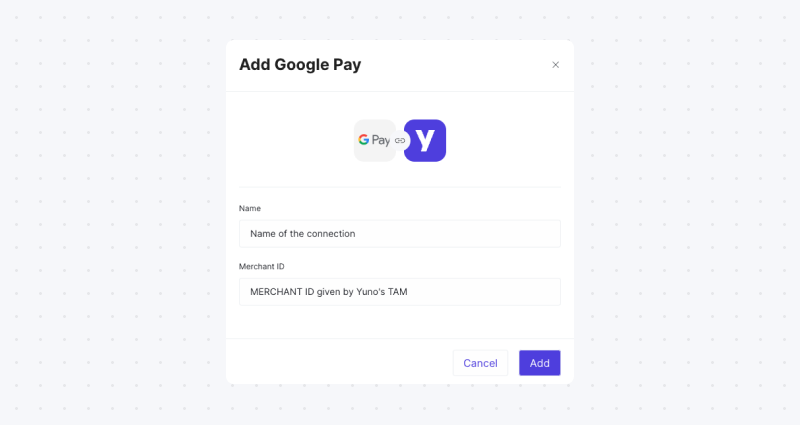

Com a integração direta, você integra a API do Google Pay™ no seu frontend, obtém o token de pagamento criptografado do Google e o envia para a API da Yuno para processamento. Isso dá a você controle total sobre a experiência do usuário com o Google Pay.

**Fluxo:** `DIRECT`

<Note>
  Não sabe qual integração usar? Consulte a [visão geral do Google Pay](/docs/google-pay#integration-options) para comparar as três opções.
</Note>

## Requisitos {#requirements}

Antes de começar, verifique se você atende aos [requisitos gerais do Google Pay](/docs/google-pay#requirements). Além disso, você precisa se cadastrar no [Google Pay Business Console](https://pay.google.com/business/console) para obter um ID de lojista do Google. Conclua a configuração do console seguindo estes passos:

1. Preencha o **Business Profile**

2. Revise as informações exigidas em **Google Pay API** > **Integrate with your website**:

   * Your website: precisa corresponder exatamente ao domínio da sua página de checkout hospedada (com ou sem "www")
   * Integration type: **GATEWAY**

3. Capturas de tela:

* Tela do meio de pagamento: a sua página de checkout hospedada
* Tela de pagamento da API do Google Pay: a folha de pagamento do Google Pay (exibida depois de clicar no botão GPay)
* Tela pós-compra: página de confirmação da transação
* Envie as capturas de tela, indique que você enviou a requisição e compartilhe o merchantId (BCR)

Use o Merchant ID atribuído para configurar a conexão do Google Pay no Dashboard da Yuno.

## Integração {#integration}

Para integrar o Google Pay com a Yuno, siga estes passos:

1. No [Dashboard da Yuno](https://dashboard.y.uno/), acesse a aba Connections. Encontre o Google Pay e clique em Connect. Insira as suas credenciais no painel lateral. Escolha um nome para a conexão e use o ID de lojista obtido no [Google Pay Business Console](https://pay.google.com/business/console) no campo Merchant ID.

<Frame></Frame>

2. Crie uma rota no Dashboard da Yuno usando o processador que você quer para os pagamentos com Google Pay. Consulte o guia [Configurar o roteamento dinâmico](/pt-br/docs/using-yuno/dashboard-overview/routing#configuring-the-dynamic-routing) para mais informações.

A Yuno processa o token de pagamento recebido do Google Pay pelo processador de pagamentos configurado. As transações do Google Pay aparecem no seu Dashboard da Yuno junto com os seus outros meios de pagamento.

## Habilite e teste o Google Pay com a Yuno {#enable-and-test-google-pay-with-yuno}

Depois da integração, você pode habilitar e testar o Google Pay com a Yuno da seguinte forma:

1. Crie uma conta de teste do Google Wallet:
   * Acesse a página [Google Wallet Test Account Sign-In](https://accounts.google.com/InteractiveLogin/signinchooser?continue=https%3A%2F%2Fpay.google.com%2Fbusiness%2Fconsole%2F\&followup=https%3A%2F%2Fpay.google.com%2Fbusiness%2Fconsole%2F\&osid=1\&passive=1209600\&ifkv=AeDOFXjl_LLJZyuykU06uleha4p7uSXJNnLCv_n2jshX6QVJYCy9AKq3K28mIfpgyfS2NDHfimnAFg\&flowName=GlifWebSignIn\&flowEntry=ServiceLogin).
   * Se você não tiver uma conta Google, crie uma para continuar.
   * Depois de entrar, você será redirecionado para o console de negócios do Google Wallet.
2. Acesse a seção da API do Google Wallet:
   * No console de negócios do Google Wallet, acesse a seção de gerenciamento de API ou de integração (normalmente nas configurações de desenvolvedor ou de integração).
3. Selecione **Create a Pass** para habilitar o **Demo Mode**:
   * Na seção da API do Google Wallet, encontre a opção **Create a Pass**.
   * Clique nessa opção para habilitar o **Demo mode**. Isso permite simular e testar a criação de passes e as interações sem transações reais.

<Frame></Frame>

4. Baixe o [aplicativo Google Wallet](https://play.google.com/store/apps/details?id=com.google.android.apps.walletnfcrel\&hl=en\&gl=US) na Play Store.
5. Percorra o fluxo de pagamento para testar a integração.

Seguindo estes passos, você garante que o Google Pay está integrado e funcionando como esperado antes de disponibilizá-lo para os seus clientes.

## Entre em produção {#go-live}

Depois de concluir todos os passos de integração no ambiente de teste, solicite o [acesso de produção do Google](https://developers.google.com/pay/api/web/guides/test-and-deploy/request-prod-access) e entre em contato com o seu Technical Account Manager. A equipe da Yuno vai ajudar a verificar a sua configuração e confirmar que você está pronto para entrar em produção.

## Detalhes de implementação {#implementation-details}

Detalhes importantes da sua integração do Google Pay com a Yuno:

### Métodos de autorização da API do Google Pay {#google-pay-api-authorization-methods}

A Yuno é compatível com os dois métodos de autorização da API do Google Pay:

* **`PAN_ONLY`**: credenciais de cartão armazenadas na conta Google do usuário. Nesse caso, a Yuno cuida automaticamente da autenticação 3D Secure, se estiver habilitada.
* **`CRYPTOGRAM_3DS`**: credenciais de cartão vinculadas ao dispositivo, com autenticação integrada. Essas credenciais incluem autenticação criptográfica e não exigem processamento 3DS adicional. Elas são descriptografadas em um número específico do dispositivo (DPAN), então consulte [Últimos quatro dígitos do cartão para tokens de dispositivo](#card-last-four-digits-for-device-tokens) se você exibe os últimos quatro dígitos do cartão para o titular do cartão.

Os dois métodos são compatíveis globalmente em todos os países onde a Yuno opera. No frontend, inclua `PAN_ONLY` e `CRYPTOGRAM_3DS` no seu array `allowedAuthMethods` para obter as maiores taxas de sucesso de pagamento.

* **3D Secure (3DS) para credenciais `PAN_ONLY`**: se o Google Pay retornar uma credencial `PAN_ONLY` (um cartão armazenado na conta Google do usuário), a Yuno cuidará automaticamente do fluxo de autenticação 3D Secure, se o 3DS estiver habilitado. No frontend, verifique se a requisição da API do Google Pay inclui `PAN_ONLY` no array `allowedAuthMethods`.
* **Configuração de Gateway e GatewayMerchantID**: ao se cadastrar no [Google Pay Business Console](https://pay.google.com/business/console), verifique se, em **Google Pay API** > **Integrate with your website**, o **Integration type** está definido como **GATEWAY**. O `Merchant ID` do Google Pay Business Console é usado no campo "Merchant ID" ao configurar a conexão do Google Pay no Dashboard da Yuno. Defina `gateway` como `yuno` e use o Merchant ID atribuído como `gatewayMerchantId` na configuração da API do Google Pay.
* **Métodos de autorização**: a Yuno é compatível com os métodos de autorização padrão (compra, autorização, captura). A disponibilidade depende do processador de pagamentos e do banco adquirente de cada país e pagamento.
* **Requisitos de endereço de cobrança**: se o processamento de pagamentos exigir o endereço de cobrança do cliente (por exemplo, para verificações AVS), configure isso na requisição da API do Google Pay. O Google fornece `BillingAddressParameters` para especificar o nível de detalhe exigido (por exemplo, MIN ou FULL). Consulte a [documentação do Google](https://developers.google.com/pay/api/web/reference/request-objects#BillingAddressParameters). Solicite os dados de endereço de cobrança apenas se for necessário, pois isso pode aumentar o atrito no checkout.
* **Dados da transação e criptografia do pagamento**: os lojistas integram os SDKs da Yuno (Android, iOS, Web) nos seus aplicativos. Quando um cliente escolhe o Google Pay, o SDK da Yuno interage com a API do Google Pay e recebe com segurança os dados de pagamento criptografados (token de pagamento) do Google. Esse token é enviado do seu aplicativo para o seu servidor de backend, que então usa as APIs server-side da Yuno para enviar o token para processamento do pagamento. A Yuno cuida da descriptografia e do processamento com o processador de pagamentos.

## Envie o token de pagamento do Google Pay na requisição {#pass-google-pay-payment-token-in-request}

<Warning>
  **Importante: protocolo ECv2 obrigatório (Android SDK v2.8.0+)**

  A partir da versão 2.8.0 do SDK Android da Yuno, apenas o protocolo ECv2 (Encrypted Card Version 2) do Google Pay é compatível. Se a sua integração do Google Pay estiver configurada para usar ECv1, os pagamentos não serão processados corretamente.

  Verifique se a configuração da API do Google Pay inclui `"protocolVersion": "ECv2"` na especificação de tokenização. O ECv1 foi descontinuado pelo Google e não é mais compatível com o SDK da Yuno.

  Se você está atualizando de uma versão anterior à 2.8.0 ou migrando de uma build personalizada do SDK, verifique se a configuração de lojista do Google Pay usa ECv2 antes de processar pagamentos. Para orientações sobre como atualizar a configuração do Google Pay, consulte a [documentação do Google](https://developers.google.com/pay/api/android/guides/resources/payment-data-cryptography#encrypted-card-version).
</Warning>

Quando você inicia uma transação com o Google Pay, é retornado um token de pagamento com os dados de pagamento criptografados. Envie o token completo recebido do Google Pay no campo `payment_method.detail.wallet.payment_token` como uma string JSON na sua requisição de pagamento.

### Objeto de resposta da carteira Google Pay {#google-pay-wallet-response-object}

O SDK do Google Pay retorna a seguinte estrutura de objeto, que precisa ser enviada como o valor completo de `payment_token`:

```json
{
  "signature": "MEQCIBvkZdkroLuBAj0K0yhqF4RfvkcWM8hW4nInpGnbSbqHAiA4emX0LkHkdnYqIiGgAQ+gF2Md5ac1DIsHItwJfwj9DQ==",
  "intermediateSigningKey": {
    "signedKey": "{\"keyValue\":\"MFkwEwYHKoZIzj0CAQYIKoZIzj0DAQcDQgAEZ8tVNZqE1G6292tV11Ff1Pc1xZDZU9Mj5QSqDaU9hMjaH+CYI7+XL+Cor0X+4r0jICgcZgQkS/q+WzY8Eku1Fg==\",\"keyExpiration\":\"1766083480615\"}",
    "signatures": [
      "MEYCIQC75wFVZ3JkWTZenVvU9WVdWzeKUvTiB2FAGtUjIP6qFgIhAP3nB97NF+2lXsqpflH/livwpy24IPSfWMF7i1pHqrw1"
    ]
  },
  "protocolVersion": "ECv2",
  "signedMessage": "{\n  \"encryptedMessage\": \"Fvw/m1KNUIAXRRd6gbbuH2eWEhARKpQL/WZBJF5GCWE9QTuJf15pJUASEIjooQa36AwbGuSUs5qtm36x/yWe8pGi4w2vNyN+bUcnw4HuxrhrPMD+VoioLwmJenHU7/ypW5wzGfOmaCWn3FQ8GjE59mfFtC+8+LPmt3Z9xcvr/wT4Qm09TNRp3k/4/6JaV2+OTYqeOER6pAvqb7WEEjRLjIapvAYKPE6VXrhIo5zdwGh2VWvxY000nkzEIbn3OKShJ/mT7ITLQF9b5J4caGGRVFBn2oobaO72I8CCpiTAWgsw3GnyQACk9ggqnXOugVWinFDDazcs0q2YF3x6fBjz8sJpODx1dTUPrOacvFzEJ9XPovYooYK3wDiRfrtwqoadG/SYlESoguIuuAx+XOdc1jP+NWy0WDVKIqAJOwsg5qkSvNS2qi3m7SKapX3EVLiw/619l9JpTIRHdiIIeOu5BtFYL86o4yb0plrE8/ivvQ2/7U4ISGxzaJ4o6PFk7RZ96nWafdT0m30JlxMmTOI6iUOtsw02SVtinwS+83xcN3s6XRAPWRjJ0d1kaUd/4kHbPy8S/UKNBjanytDwDzn6wEccluisI4E=\",\n  \"ephemeralPublicKey\": \"BPUzeogQZAp0N4D3vLYrvQ7Hc+fc261ZW17LIoMnIAgcWaANAhM39Z8mDCYxpiNIO/F0WtOkJhcvVZFSnI/yq/w=\",\n  \"tag\": \"owzrWByO1bNLbw9m/G2kzGmWDnBCs7QoMN+N0zovZAo=\"\n}"
}
```

### Exemplo de requisição {#request-example}

```json
{
  "account_id": "d34257e7-55d4-44cf-8b90-3a5152bbe020",
  "description": "Google Pay test",
  "merchant_order_id": "MER01",
  "country": "US",
  "amount": {
    "currency": "USD",
    "value": 1
  },
  "customer_payer": {
    "email": "testing@y.uno"
  },
  "workflow": "DIRECT",
  "payment_method": {
    "detail": {
      "wallet": {
        "payment_token": "{\"signature\":\"MEQCIBvkZdkroLuBAj0K0yhqF4RfvkcWM8hW4nInpGnbSbqHAiA4emX0LkHkdnYqIiGgAQ+gF2Md5ac1DIsHItwJfwj9DQ\\u003d\\u003d\",\"intermediateSigningKey\":{\"signedKey\":\"{\\\"keyValue\\\":\\\"MFkwEwYHKoZIzj0CAQYIKoZIzj0DAQcDQgAEZ8tVNZqE1G6292tV11Ff1Pc1xZDZU9Mj5QSqDaU9hMjaH+CYI7+XL+Cor0X+4r0jICgcZgQkS/q+WzY8Eku1Fg\\\\u003d\\\\u003d\\\",\\\"keyExpiration\\\":\\\"1766083480615\\\"}\",\"signatures\":[\"MEYCIQC75wFVZ3JkWTZenVvU9WVdWzeKUvTiB2FAGtUjIP6qFgIhAP3nB97NF+2lXsqpflH/livwpy24IPSfWMF7i1pHqrw1\"]},\"protocolVersion\":\"ECv2\",\"signedMessage\":\"{\\\"encryptedMessage\\\":\\\"Fvw/m1KNUIAXRRd6gbbuH2eWEhARKpQL/WZBJF5GCWE9QTuJf15pJUASEIjooQa36AwbGuSUs5qtm36x/yWe8pGi4w2vNyN+bUcnw4HuxrhrPMD+VoioLwmJenHU7/ypW5wzGfOmaCWn3FQ8GjE59mfFtC+8+LPmt3Z9xcvr/wT4Qm09TNRp3k/4/6JaV2+OTYqeOER6pAvqb7WEEjRLjIapvAYKPE6VXrhIo5zdwGh2VWvxY000nkzEIbn3OKShJ/mT7ITLQF9b5J4caGGRVFBn2oobaO72I8CCpiTAWgsw3GnyQACk9ggqnXOugVWinFDDazcs0q2YF3x6fBjz8sJpODx1dTUPrOacvFzEJ9XPovYooYK3wDiRfrtwqoadG/SYlESoguIuuAx+XOdc1jP+NWy0WDVKIqAJOwsg5qkSvNS2qi3m7SKapX3EVLiw/619l9JpTIRHdiIIeOu5BtFYL86o4yb0plrE8/ivvQ2/7U4ISGxzaJ4o6PFk7RZ96nWafdT0m30JlxMmTOI6iUOtsw02SVtinwS+83xcN3s6XRAPWRjJ0d1kaUd/4kHbPy8S/UKNBjanytDwDzn6wEccluisI4E\\\\u003d\\\",\\\"ephemeralPublicKey\\\":\\\"BPUzeogQZAp0N4D3vLYrvQ7Hc+fc261ZW17LIoMnIAgcWaANAhM39Z8mDCYxpiNIO/F0WtOkJhcvVZFSnI/yq/w\\\\u003d\\\",\\\"tag\\\":\\\"owzrWByO1bNLbw9m/G2kzGmWDnBCs7QoMN+N0zovZAo\\\\u003d\\\"}\"}"
      }
    },
    "type": "GOOGLE_PAY"
  }
}
```

## Pagamentos recorrentes (CIT e MIT) {#recurring-payments-cit-and-mit}

Para cobranças recorrentes, salve o instrumento no vault no primeiro pagamento e cobre o `vaulted_token` resultante depois. No CIT, `payment_token` e `stored_credentials` ficam juntos em `detail.wallet`. No MIT, o instrumento é um cartão armazenado, então `stored_credentials` passa para `detail.card`. A matriz completa de `reason` e `usage` está em [Credenciais armazenadas](/pt-br/docs/payment-features/stored-credentials#wallet-originated-tokens-apple-pay-and-google-pay).

CIT, primeiro pagamento com a folha do Google Pay exibida:

```json
"payment_method": {
  "type": "GOOGLE_PAY",
  "vault_on_success": true,
  "detail": {
    "wallet": {
      "payment_token": "{\"protocolVersion\":\"ECv2\", ...}",
      "stored_credentials": {
        "reason": "SUBSCRIPTION",
        "usage": "FIRST"
      }
    }
  }
}
```

MIT, cobrança posterior no instrumento salvo no vault, sem token do Google Pay:

```json
"payment_method": {
  "type": "CARD",
  "vaulted_token": "vaulted-token-from-the-cit-response",
  "detail": {
    "card": {
      "stored_credentials": {
        "reason": "SUBSCRIPTION",
        "usage": "USED"
      }
    }
  }
}
```

`vault_on_success` exige `customer_payer.id`. `customer_payer.id` precisa fazer referência a um cliente existente (crie-o antes com [Criar cliente](/reference/customers/create-customer)). Sem ele, o pagamento ainda é bem-sucedido, mas nada é salvo no vault: a resposta traz um `vaulted_token` vazio e nenhum erro. O `vaulted_token` é retornado apenas na resposta do pagamento CIT, então armazene-o do seu lado. Não coloque `stored_credentials` em `detail.card` no CIT: o campo não é validado em um pagamento com carteira e pode ser descartado, o que deixa o registro salvo sem as flags de credencial armazenada e sem um `network_transaction_id`.

## Últimos quatro dígitos do cartão para tokens de dispositivo {#card-last-four-digits-for-device-tokens}

Quando o Google Pay retorna uma credencial `CRYPTOGRAM_3DS`, o token criptografado é descriptografado no **DPAN**, um número específico do dispositivo, e não no cartão armazenado pelo titular do cartão. Os últimos quatro dígitos dele não são os que o titular do cartão reconhece, então `card_data.lfd` na resposta do pagamento fica vazio ou mostra os últimos quatro dígitos do DPAN.

Os últimos quatro dígitos do cartão real estão disponíveis para você na resposta do Google, fora do token criptografado:

```json
{
  "paymentMethodData": {
    "info": {
      "cardDetails": "1515",
      "cardNetwork": "VISA"
    },
    "tokenizationData": {
      "token": "..."
    }
  }
}
```

Envie `paymentMethodData.info.cardDetails` como `payment_method.detail.wallet.card_data.lfd` e a Yuno usa esse valor no lugar do valor derivado do DPAN.

```json
{
  "payment_method": {
    "type": "GOOGLE_PAY",
    "detail": {
      "wallet": {
        "payment_token": "{\"protocolVersion\":\"ECv2\", ...}",
        "card_data": {
          "lfd": "1515"
        }
      }
    }
  }
}
```

| Campo | Tipo | Obrigatório | Descrição |
| :---- | :--- | :------- | :---------- |
| `lfd` | string | Não | Últimos quatro dígitos do cartão real do titular do cartão, obtidos de `paymentMethodData.info.cardDetails`. Precisa ter exatamente 4 dígitos numéricos. |

O campo é opcional e compatível com versões anteriores. Se você não o enviar, o comportamento não muda.

* A Yuno aplica o valor apenas quando o token é um token de dispositivo: `auth_method` é `CRYPTOGRAM_3DS`, ou `pan_type` é `DPAN` quando `auth_method` está ausente.
* As credenciais `PAN_ONLY` ignoram o valor. Elas são descriptografadas no cartão real, então a Yuno mantém os últimos quatro dígitos descriptografados.
* Apenas `lfd` é aceito. `brand` e os demais campos do cartão mantêm os valores descriptografados, porque o BIN do DPAN já identifica corretamente a bandeira do cartão.
* O valor é ignorado em outras carteiras, como o Apple Pay.

Depois de aplicado, o valor aparece na resposta de criação do pagamento, na resposta do Get payment by ID e nos webhooks de pagamento, em `payment_method.detail.card.card_data.lfd`. Nos payloads de webhook, ele fica em `payment_method_detail` em vez de `detail`.

Se `lfd` estiver presente, mas não tiver exatamente 4 dígitos numéricos, a requisição é rejeitada:

```json
{
  "code": "INVALID_REQUEST",
  "messages": [
    "Invalid Request. payment_method.detail.wallet.card_data.lfd must be exactly 4 numeric digits."
  ]
}
```

## Documentação relacionada {#related-documentation}

* [Visão geral do Google Pay](/docs/google-pay)
* [Integração do Google Pay via SDK](/pt-br/docs/wallets/google-pay/google-pay-sdk-integration)
* [Google Pay via provedor](/pt-br/docs/wallets/google-pay/integration-via-provider-google-pay)
* [Google Pay com PIX](/pt-br/docs/wallets/google-pay/google-pay-with-pix)