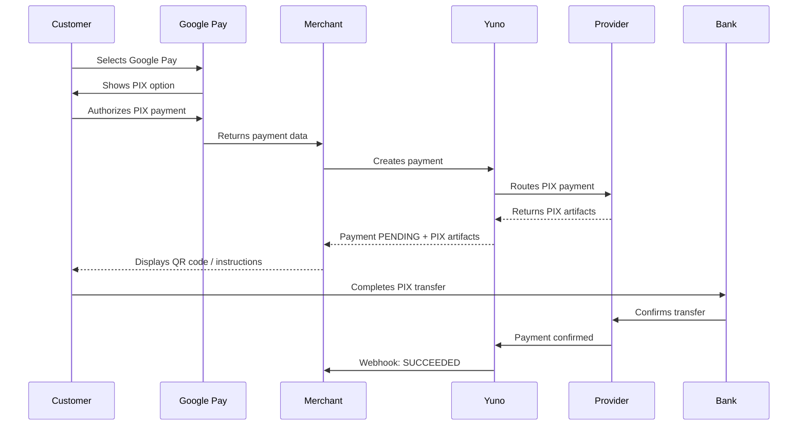
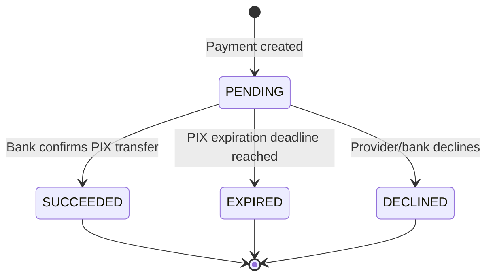

No Brasil, a Yuno oferece suporte ao Google Pay™ como interface para pagamentos via PIX. Os clientes selecionam o Google Pay no checkout, e o pagamento é processado via PIX, o sistema de pagamentos instantâneos do Brasil. Isso combina a conveniência dos meios de pagamento salvos no Google Pay com a liquidação em tempo real do PIX.

<Note>
  O Google Pay com PIX está disponível apenas no Brasil, com transações em BRL (real brasileiro).
</Note>

## O que é o Google Pay PIX {#what-is-google-pay-pix}

O Google Pay PIX usa o **Open Finance** para permitir pagamentos via PIX pela carteira do Google Pay. Em vez de abrir o app do banco para concluir uma transferência PIX, os clientes podem pagar diretamente pela Google Wallet, o que torna a experiência de checkout mais rápida e conveniente.

Para pagar com o Google Pay PIX, o cliente final precisa primeiro configurar uma conta bancária para pagamentos via PIX na Google Wallet. O Google fornece instruções de configuração em [Configurar o PIX na Google Wallet](https://support.google.com/wallet/answer/14600929?hl=pt-BR).

## Como funciona {#how-it-works}

Do ponto de vista do lojista, um pagamento com Google Pay + PIX se comporta como um pagamento PIX assíncrono padrão, mesmo que o cliente comece no Google Pay.

1. O cliente seleciona o Google Pay no checkout.
2. O Google Pay apresenta o PIX como uma opção de pagamento na folha de pagamento do Google Pay.
3. O cliente seleciona um banco ou uma credencial que possa iniciar uma transferência PIX e autoriza o pagamento.
4. A Yuno cria o pagamento com o status `PENDING` e retorna os artefatos padrão do PIX (QR code, código copia e cola ou deeplink), dependendo do provedor e da configuração. Veja os [campos de resposta do PIX](/reference/payments/payment-examples/bank-transfer#pix) para os nomes exatos dos campos.
5. O cliente conclui a transferência PIX pelo banco.
6. O banco confirma a transferência ao provedor, que notifica a Yuno.
7. A Yuno atualiza o status do pagamento para `SUCCEEDED` e dispara um webhook.



## Provedores compatíveis {#supported-providers}

O Google Pay PIX está disponível atualmente pelos seguintes provedores:

* **Adyen**
* **Santander**
* **Itau**

Para outros provedores, entre em contato com o seu gerente de conta da Yuno para discutir a disponibilidade e priorizar a integração.

## Requisitos {#requirements}

* Uma conta da Yuno com uma conexão a um [provedor compatível](#supported-providers)
* As transações devem ser em **BRL** (real brasileiro)
* O cliente precisa ter uma conta bancária configurada para o PIX na [Google Wallet](https://support.google.com/wallet/answer/14600929?hl=pt-BR)

## Integração {#integration}

O Google Pay com PIX segue os mesmos padrões de integração do Google Pay com pagamentos com cartão. Escolha o método de integração que se adapta à sua arquitetura:

* **[Integração via SDK](/pt-br/docs/wallets/google-pay/google-pay-sdk-integration)**: o SDK da Yuno cuida de todo o fluxo, inclusive de apresentar o PIX como uma opção dentro do Google Pay.
* **[Integração direta](/pt-br/docs/wallets/google-pay/google-pay-direct-integration)**: você gerencia o frontend do Google Pay e passa o token de pagamento PIX para a Yuno.
* **[Integração via provedor](/pt-br/docs/wallets/google-pay/integration-via-provider-google-pay)**: o seu provedor de pagamento cuida do fluxo Google Pay + PIX.

Ao criar o pagamento, defina `payment_method.type` como `GOOGLE_PAY_PIX`. Isso informa à Yuno que o pagamento é uma transação PIX iniciada pelo Google Pay.

## Requisição de pagamento {#payment-request}

Crie um pagamento usando o tipo de meio de pagamento `GOOGLE_PAY_PIX`. Defina o país como `BR` e a moeda como `BRL`:

```json
{
  "account_id": "your-account-id",
  "description": "Google Pay PIX payment",
  "merchant_order_id": "order-456",
  "country": "BR",
  "amount": {
    "currency": "BRL",
    "value": 5000
  },
  "customer_payer": {
    "email": "customer@example.com"
  },
  "payment_method": {
    "type": "GOOGLE_PAY_PIX"
  }
}
```

<Note>
  Para o Google Pay PIX, use `payment_method.type = GOOGLE_PAY_PIX` em vez de `GOOGLE_PAY`. Isso é diferente dos pagamentos com cartão via Google Pay, que usam `GOOGLE_PAY`.
</Note>

## Status do pagamento {#payment-statuses}

O Google Pay com PIX é **assíncrono**. Ao contrário dos pagamentos com cartão via Google Pay, que normalmente são resolvidos na hora, os pagamentos PIX passam por um estado pendente enquanto aguardam a conclusão da transferência bancária.

| Status      | Descrição                                                         |
| ----------- | ----------------------------------------------------------------- |
| `PENDING`   | Pagamento criado. A transferência PIX ainda não foi concluída.    |
| `SUCCEEDED` | O banco confirmou a transferência PIX. Os fundos foram liquidados. |
| `EXPIRED`   | O pagamento PIX não foi concluído antes do prazo de expiração.    |
| `DECLINED`  | O pagamento foi recusado pelo provedor ou pelo banco.             |

### Ciclo de vida do status {#status-lifecycle}



## Como lidar com o cancelamento pelo usuário {#handling-user-cancellation}

Se o cliente fechar a folha do Google Pay ou a tela de instruções do PIX antes de concluir a transferência bancária:

* O **frontend/SDK** informa que o usuário saiu do fluxo (por exemplo, o SDK retorna um status de cancelamento pelo usuário).
* O **pagamento na API continua `PENDING`**. A referência PIX ainda é válida e o cliente ainda pode concluir a transferência pelo app do banco.
* O pagamento PIX só passa para `EXPIRED` quando o prazo de expiração é atingido, não quando o usuário fecha a interface.

O seu checkout deve lidar com isso:

1. **Exibindo novamente as instruções do PIX** se o cliente voltar à mesma sessão, já que a referência PIX ainda é válida.
2. **Permitindo que o cliente pague depois**, se a sua UX oferecer suporte a isso. O código PIX continua ativo até expirar.
3. **Consultando o status do pagamento** via `GET /v1/payments/{id}` ou escutando webhooks para detectar quando a transferência é concluída.

## Webhooks {#webhooks}

Os webhooks padrão de pagamento são disparados em todas as transições de status. O payload do webhook segue a mesma estrutura de qualquer outra notificação de pagamento da Yuno.

Monitore estes eventos:

* **Pagamento bem-sucedido**: a transferência PIX foi concluída. Atualize o status do seu pedido e confirme ao cliente.
* **Pagamento expirado**: o prazo do PIX passou sem uma transferência. Pare de exibir o QR code ou as instruções do PIX e peça ao cliente que inicie um novo pagamento.

Veja [Webhooks](/docs/webhooks) para detalhes de configuração.

## Diferenças em relação aos pagamentos com cartão {#differences-from-card-payments}

| Aspecto                        | Google Pay com cartões           | Google Pay com PIX                            |
| ------------------------------ | -------------------------------- | --------------------------------------------- |
| Processamento                  | Normalmente síncrono             | Assíncrono (PENDING até o banco confirmar)    |
| Liquidação                     | Depende do provedor e do adquirente | Instantânea (rede PIX)                     |
| Moeda                          | Várias moedas compatíveis        | Apenas BRL                                    |
| País                           | Disponibilidade global           | Apenas Brasil                                 |
| Reembolsos                     | Fluxo de reembolso padrão        | Fluxo de reembolso do PIX                     |
| Pagamentos recorrentes         | Compatível via tokens armazenados | Não compatível                               |
| Ação do cliente após o checkout | Nenhuma                         | Precisa concluir a transferência PIX pelo banco |
| Expiração                      | N/A                              | A referência PIX expira conforme as regras do provedor/da Yuno |

## Documentação relacionada {#related-documentation}

* [Visão geral do Google Pay](/docs/google-pay)
* [Integração do Google Pay via SDK](/pt-br/docs/wallets/google-pay/google-pay-sdk-integration)
* [Integração direta do Google Pay](/pt-br/docs/wallets/google-pay/google-pay-direct-integration)
* [Google Pay via provedor](/pt-br/docs/wallets/google-pay/integration-via-provider-google-pay)