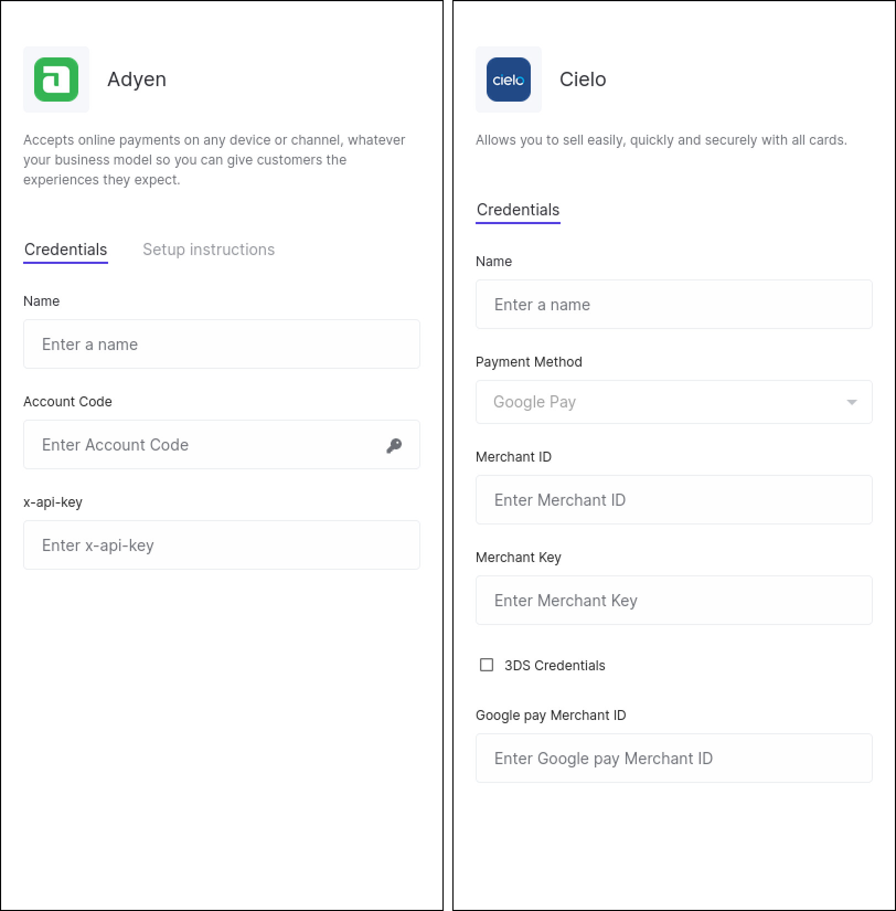

Com a integração via provedor, o Google Pay™ é tratado inteiramente pelo seu provedor de pagamento (por exemplo, Adyen, Cielo). A Yuno roteia a transação para o provedor, que gerencia a descriptografia e o processamento do token do Google Pay. Os dados do cartão não passam pela Yuno nesse fluxo.

Essa opção é ideal se você já usa a solução de Google Pay de um provedor ou se o provedor gerencia o processo de certificação do Google Pay em seu nome.

<Note>
  Não sabe qual integração usar? Consulte a [visão geral do Google Pay](/docs/google-pay#integration-options) para comparar as três opções.
</Note>

## Requisitos {#requirements}

Verifique se você atende aos [requisitos gerais do Google Pay](/docs/google-pay#requirements).

## Provedores {#providers}

Para incorporar o Google Pay ao seu sistema usando a Yuno, primeiro selecione um provedor que suporte esse meio de pagamento.

Você precisa ter credenciais para se conectar ao provedor selecionado usando o [dashboard da Yuno](https://dashboard.y.uno/) antes de integrar o Google Pay.

## Integração {#integration}

Você precisa cumprir algumas etapas para integrar o Google Pay ao seu sistema usando a Yuno.

1. Primeiro, revise o processo de aprovação do Google para [dispositivos Android](https://developers.google.com/pay/api/android/overview) ou para o [Google Pay na Web](https://developers.google.com/pay/api/web/overview).
   1. Comece verificando os Termos de Serviço e a Política de Uso Aceitável.
   2. Conclua os tutoriais e o checklist de integração.
   3. Conclua o checklist de integração para [Android](https://developers.google.com/pay/api/android/guides/test-and-deploy/integration-checklist) ou [Web](https://developers.google.com/pay/api/web/guides/test-and-deploy/integration-checklist) antes de solicitar as credenciais de produção ao Google.
   4. Por fim, solicite seu acesso de produção.
2. Obtenha as credenciais de desenvolvedor do provedor que você escolher para começar a usar com a Yuno.

<Note>
**Conexão com a Adyen**

Para a Adyen, os lojistas precisam criar uma [conta de teste](https://www.adyen.com/signup) e obter uma **Merchant Account** e uma **x-api-key**.
</Note>

1. No [dashboard da Yuno](https://dashboard.y.uno/), selecione a aba **Connections**. Encontre o provedor escolhido e clique em **Connect**. Preencha os campos do painel lateral com suas credenciais. Abaixo, você encontra exemplos dos painéis de conexão da Adyen e da Cielo.

<Frame></Frame>

4. Crie uma rota no dashboard da Yuno usando o gateway que você conectou. Acesse a página do guia [Configurar o roteamento dinâmico](/pt-br/docs/using-yuno/dashboard-overview/routing#configuring-the-dynamic-routing) para obter mais informações sobre como criar rotas.

## Ativar e testar o Google Pay com a Yuno {#enable-and-test-google-pay-with-yuno}

Depois de realizar a integração na Yuno, você pode ativar o Google Pay com a Yuno e realizar testes de integração seguindo estas etapas:

1. Primeiro, integre o [SDK da Yuno](/docs/sdks/full-checkout/android-payments) ao seu app.
2. Crie uma conta de teste do Google Wallet:
   1. Acesse a página [Google Wallet Test Account Sign-In](https://accounts.google.com/InteractiveLogin/signinchooser?continue=https%3A%2F%2Fpay.google.com%2Fbusiness%2Fconsole%2F\&followup=https%3A%2F%2Fpay.google.com%2Fbusiness%2Fconsole%2F\&osid=1\&passive=1209600\&ifkv=AeDOFXjl_LLJZyuykU06uleha4p7uSXJNnLCv_n2jshX6QVJYCy9AKq3K28mIfpgyfS2NDHfimnAFg\&flowName=GlifWebSignIn\&flowEntry=ServiceLogin).
   2. Se você não tiver uma conta do Google, precisará criar uma para continuar.
   3. Depois de fazer login, você será redirecionado para o console de negócios do Google Wallet.
3. Acesse a seção da API do Google Wallet:
   1. No console de negócios do Google Wallet, acesse a seção relacionada ao gerenciamento ou à integração de API. Ela fica nas configurações de desenvolvedor ou de integração.
4. Selecione **Create a Pass** para ativar o **Demo Mode**:
   1. Na seção da API do Google Wallet, localize a opção **Create a Pass**.
   2. Clique nessa opção para ativar o **Demo mode**. Esse modo permite simular e testar a criação de passes e as interações sem fazer transações reais.

<Frame></Frame>

5. Baixe o app Google Wallet na Play Store.
6. Percorra o fluxo de pagamento para testar a integração.

Seguindo essas etapas, você garante que o Google Pay esteja integrado ao seu app e funcione como esperado antes de disponibilizá-lo para seus clientes.

## Detalhes de implementação {#implementation-details}

A Yuno suporta os dois métodos de autorização da API do Google Pay:

* **`PAN_ONLY`**: credenciais de cartão armazenadas na conta Google do usuário. Quando esse método é usado, o provedor selecionado trata a autenticação conforme configurado.
* **`CRYPTOGRAM_3DS`**: credenciais de cartão vinculadas ao dispositivo, com autenticação integrada. Essas credenciais incluem autenticação criptográfica.

Os dois métodos são suportados globalmente em todos os países onde a Yuno opera. No frontend, inclua `PAN_ONLY` e `CRYPTOGRAM_3DS` no seu array `allowedAuthMethods` para obter as maiores taxas de sucesso de pagamento.

* **Configuração específica do provedor**: o tratamento dos métodos de autorização do Google Pay pode variar de acordo com o provedor selecionado. Consulte a documentação do seu provedor para conhecer os requisitos e recursos específicos de processamento de `PAN_ONLY` e `CRYPTOGRAM_3DS`.

## Documentação relacionada {#related-documentation}

* [Visão geral do Google Pay](/docs/google-pay)
* [Integração do Google Pay via SDK](/pt-br/docs/wallets/google-pay/google-pay-sdk-integration)
* [Integração direta do Google Pay](/pt-br/docs/wallets/google-pay/google-pay-direct-integration)
* [Google Pay com PIX](/pt-br/docs/wallets/google-pay/google-pay-with-pix)