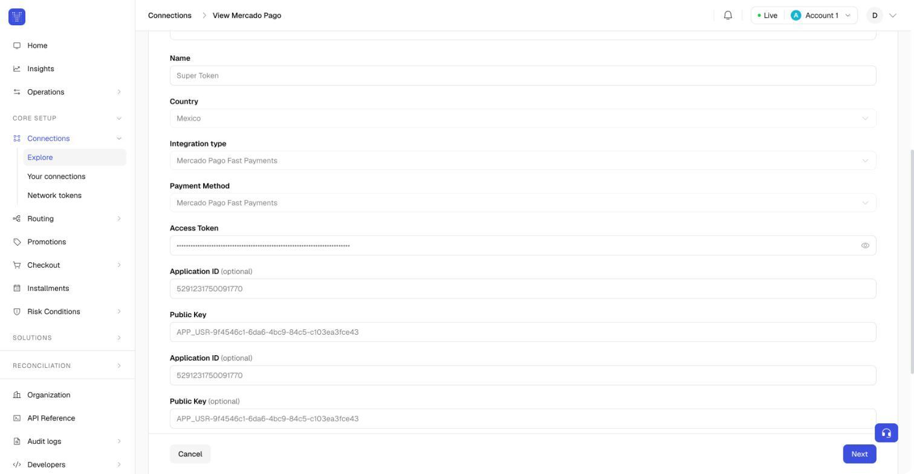
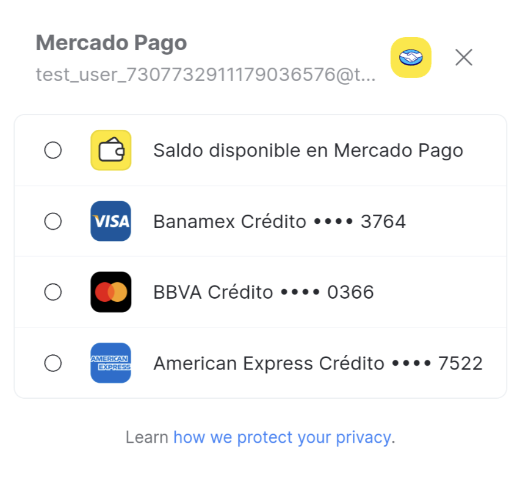

O Mercado Pago Fast Payments mostra ao comprador os meios de pagamento que ele já salvou na conta do Mercado Pago (cartões e saldo em conta) dentro do seu checkout da Yuno. O comprador escolhe um, confirma com o Mercado Pago e paga sem digitar de novo os dados do cartão nem sair da sua página.

A Yuno renderiza a experiência dentro da lista de meios de pagamento do Yuno SDK 2.0 e no **Full checkout** e no **Lite checkout** do Web SDK v1.11. Você cria a sessão de checkout e o pagamento como já faz hoje; o SDK cuida da parte do Mercado Pago.

<Note>
O Mercado Pago Fast Payments é compatível com o **Yuno SDK 2.0.0** (recomendado, com headless disponível a partir da **2.7.1**) e com o **Web SDK v1.11.21** ou posterior (`https://sdk-web.y.uno/v1.11/main.js`).

Os SDKs legados continuam compatíveis em paralelo durante a transição e têm descontinuação prevista para **2027**. O caminho recomendado pela Yuno é migrar para o novo Yuno SDK em vez de permanecer em um SDK legado. Consulte o [guia de migração](/pt-br/docs/yuno-sdk/migration/overview). Fale com o seu Account Manager para planejar a migração.
</Note>

## Disponibilidade {#availability}

O Fast Payments está disponível em:

* **Lista de meios de pagamento do Yuno SDK 2.0** (`getPaymentMethodsViews`), com a sessão de checkout criada com `workflow: 'SDK_SEAMLESS'`
* **`start()` headless do Yuno SDK** na Web, a partir da versão 2.7.1, quando a sua página executa o SDK do Mercado Pago e monta ela mesma a experiência do comprador. Consulte [Integração headless](#headless-integration).
* **Full checkout do Web SDK v1.11** (`mountCheckout`)
* **Lite checkout do Web SDK v1.11** (`mountCheckoutLite`) com `paymentMethodType: 'MERCADO_PAGO_SUPERTOKEN'`, com suporte aos modos de renderização `element` e `modal` (o Mercado Pago recomenda `element`).

Ele não está disponível no Seamless checkout do Web SDK v1, na lista condensada de meios de pagamento, no checkout da Moon Active nem nos SDKs mobile nativos.

### Compatibilidade e suporte por plataforma {#compatibility-and-platform-support}

O Fast Payments funciona dentro de contextos web e exige a autenticação do comprador no Mercado Pago.

| Plataforma / ambiente | Nível de suporte | Observações |
| --- | --- | --- |
| **Web desktop** | Compatível | Navegadores modernos sempre atualizados (Chrome, Safari, Firefox, Edge). |
| **Web mobile** | Compatível | Safari no iOS, Chrome no Android e navegadores mobile. |
| **WebView** | Ainda não validado | O Fast Payments ainda não foi validado em uma WebView. Não presuma que há suporte nesse caso. |
| **App mobile nativo** | Não compatível | Os SDKs nativos de iOS e Android ainda não são compatíveis com o Fast Payments. |

<Note>
A exibição nos ambientes compatíveis depende da **elegibilidade do comprador**. Se o comprador não tiver uma conta válida no Mercado Pago, ou se o Mercado Pago não conseguir autenticar a sessão, o Fast Payments não é oferecido. O que o comprador vê nesse caso depende da sua integração, descrita em [Como funciona para o comprador](#how-it-works-for-the-shopper).
</Note>

## Limitações funcionais {#functional-limitations}

Antes de planejar a sua integração, revise os limites funcionais em que o Fast Payments não deve ser usado:

* **Recorrência e transações iniciadas pelo lojista (MIT):** o Fast Payments exige autenticação interativa do comprador. Ele não pode ser usado para cobrança recorrente de assinatura, armazenamento de cartões tokenizados para cobranças futuras fora da sessão nem fluxos MIT.
* **Cupons e promoções do Mercado Pago:** descontos do Mercado Pago dentro do app ou códigos de cupom do lojista gerenciados dentro do Mercado Pago não podem ser aplicados pelo Fast Payments.
* **Captura parcial ou valores diferentes:** autorizar um valor e depois capturar um valor diferente ou parcial não é compatível. O valor capturado deve ser igual ao valor autorizado no checkout.
* **Campos de subadquirente:** parâmetros personalizados de subadquirente ou flags de processamento de intermediários não são repassados ao Mercado Pago.
* **Splits de pagamento:** splits de pagamento 1:1 não são compatíveis. Cenários de split de pagamento 1:N estão em validação e não estão disponíveis para uso geral.

## Ativação e pré-requisitos {#onboarding-and-prerequisites}

A ativação do Mercado Pago Fast Payments exige uma configuração coordenada entre o lojista, a Yuno e o Mercado Pago:

1. **Ative o Fast Payments** (Mercado Pago e lojista, no Mercado Pago Developers). Solicite a ativação do Fast Payments na sua aplicação do Mercado Pago com o seu gerente de conta do Mercado Pago.
2. **Autorize a conexão** (lojista, no Yuno Dashboard). Em **Settings > Connections**, execute **Connect with Mercado Pago** para gerar os access tokens do vendedor.
3. **Configure as chaves públicas** (lojista, no Yuno Dashboard). Adicione a chave pública de cada site do Mercado Pago em que você vende, marcada com o país correspondente. Adicione uma chave marcada como `GLOBAL` como alternativa.
4. **Configure o webhook** (lojista, no Mercado Pago Developers). Defina a Notification URL como `https://prod.y.uno/mercadopago-webhook/v1/orders/events` e assine o evento **Order (Mercado Pago)**.
5. **Ative as regras de roteamento** (Yuno e lojista, no Yuno Dashboard). Ative o meio de pagamento `MERCADO_PAGO_SUPERTOKEN` no seu workflow de roteamento do checkout.

<Frame caption="Configuração da conexão do Mercado Pago Fast Payments no Yuno Dashboard">
  
</Frame>

## Como funciona para o comprador {#how-it-works-for-the-shopper}

### Full checkout {#full-checkout}

No Full checkout, o Mercado Pago sempre aparece como **uma seção** no topo da lista de meios de pagamento, encabeçada pelo logo do Mercado Pago. Ele nunca é uma linha selecionável por si só: o comprador seleciona um dos meios dentro da seção. A seção se adapta ao que a Yuno sabe sobre o comprador:

| Situação | O que o comprador vê |
| --- | --- |
| A sessão de checkout não tem o e-mail do comprador | Um campo que pede o e-mail da conta do Mercado Pago: *"Informe o e-mail da sua conta do Mercado Pago para ver os seus meios de pagamento salvos."* |
| O e-mail é conhecido e o Mercado Pago está carregando os meios dele | Um placeholder enquanto a lista carrega |
| O Mercado Pago respondeu | Os cartões salvos e o saldo em conta como linhas, cada uma com a bandeira e os últimos dígitos. O Mercado Pago pode pedir o código de segurança do cartão antes do pagamento com um cartão salvo, em um campo que o próprio Mercado Pago renderiza |
| Não foi possível acessar o Mercado Pago, ele não retornou meios ou o comprador não é elegível | A seção do Mercado Pago não é exibida. O comprador vê os seus outros meios de pagamento. Se o Mercado Pago for o único meio de pagamento que você ativou, uma única linha do Mercado Pago é exibida no lugar, para que a lista nunca fique vazia, e ao selecioná-la aparece a mensagem de indisponibilidade |

<Frame caption="Mercado Pago Fast Payments exibindo os meios de pagamento salvos do comprador">
  
</Frame>

Em todos os estados, a seção mantém um aviso de privacidade (*"Saiba como protegemos a sua privacidade."*) com link para a página de privacidade do Mercado Pago do país do comprador (por exemplo, `https://www.mercadopago.com.ar/privacidad` para a Argentina). Os seus outros meios de pagamento vêm em seguida, sob o título **Other payment methods**.

<Note>
Ocultar a seção é o comportamento a partir do Web SDK **1.11.21**. Da **1.11.6** à **1.11.20**, uma única linha do Mercado Pago permanece na lista, e o comprador que seleciona essa linha vê a mensagem *"O Mercado Pago não está disponível no momento. Escolha outro meio de pagamento."* Atualize para a 1.11.21 ou posterior para manter essa mensagem fora do caminho do comprador.
</Note>

<Tip>
Envie o e-mail do comprador em `customer_payer.email` ao [criar a sessão de checkout](/reference/checkout-sessions/create-checkout-session). Assim, a seção carrega os meios salvos imediatamente, em vez de pedir o e-mail ao comprador.
</Tip>

### Lite checkout {#lite-checkout}

No Lite checkout, o SDK renderiza o componente do Mercado Pago no contêiner configurado para `paymentMethodType: 'MERCADO_PAGO_SUPERTOKEN'`. Os compradores selecionam os meios salvos no Mercado Pago e se autenticam com eles diretamente dentro desse componente montado (ou modal).

Assim como no Full checkout, o componente exibe o aviso de privacidade com link para a política de privacidade do Mercado Pago do país do comprador.

Como no Lite checkout é a sua própria página que controla a lista de meios de pagamento, a Yuno não consegue remover dela a entrada do Mercado Pago. Quando o Mercado Pago não pode ser usado, ou o comprador não é elegível, o componente montado exibe a mensagem *"O Mercado Pago não está disponível no momento. Escolha outro meio de pagamento."*

## Responsabilidades de UI e identidade visual {#ui-responsibilities-and-branding}

Ao integrar o Fast Payments (principalmente em configurações personalizadas ou headless), é essencial saber qual camada é responsável por cada elemento:

* **Responsabilidades da UI do lojista:**
  * Renderizar o seletor de meio de pagamento e os itens da lista (cartões, saldo em conta e outros meios de pagamento do lojista).
  * Renderizar as opções de parcelamento usando exatamente os dados fornecidos pelo Mercado Pago (valores, rótulos de taxa de juros).
  * Gerenciar os estados dos botões: desativar ou bloquear os botões de envio durante a inicialização da carteira, a autenticação ou a criação do token, para evitar cliques duplicados.
  * Acionar o indicador de carregamento da Yuno via `showLoading` durante a execução do pagamento e tratar os erros de forma adequada.
* **Responsabilidades do SDK do Mercado Pago:**
  * Hospedar e renderizar o iframe do campo de CVV / código de segurança (`wallet.mountSecurityCode()`) quando exigido para cartões de crédito/débito salvos.
  * Renderizar os modais de autenticação biométrica ou multifator (desafios OTP / FIDO).
  * Fornecer a URL oficial e localizada da política de privacidade (`wallet.privacyPolicyUrl`).
* **Requisitos de identidade visual e de recursos:**
  * **Logo:** use o logo oficial do Mercado Pago (`https://icons.prod.y.uno/mercadopago_logosimbolo.png`) junto ao título da seção ou à entrada do meio.
  * **Posicionamento:** exiba o Mercado Pago em destaque no topo das opções de pagamento para maximizar a conversão dos compradores com sessão iniciada.
  * **Política de privacidade:** sempre que mostrar meios do Mercado Pago, exiba um link para o aviso de privacidade do Mercado Pago usando `wallet.privacyPolicyUrl` (por exemplo, *"Saiba como protegemos a sua privacidade"*).

## Integração {#integration}

### Mapeamento de workflow {#workflow-mapping}

Defina `workflow` na sessão de checkout (`POST /v1/checkout/sessions`) de acordo com o SDK que você integra:

| SDK e experiência | Valor de `workflow` | Fast Payments | Observações |
| --- | --- | --- | --- |
| **Yuno SDK 2.0** (lista de meios de pagamento) | `SDK_SEAMLESS` | Sim | Obrigatório no Yuno SDK 2.0: permite que o SDK crie o pagamento. Sem ele, a transação termina em `INTERNAL_ERROR`. |
| **`start()` headless do Yuno SDK** | `SDK_SEAMLESS` | Sim | A sua página executa o SDK do Mercado Pago. Crie uma sessão de checkout por pagamento. Compatível com o SDK **v2.7.1+**. |
| **Full checkout do Web SDK v1.11** | `SDK_CHECKOUT` | Sim | A seção do Mercado Pago é renderizada no topo da lista de meios de pagamento. |
| **Lite checkout do Web SDK v1.11** (`element` ou `modal`) | `SDK_CHECKOUT` | Sim | O Mercado Pago recomenda `element`. |
| **Seamless checkout do Web SDK v1.11** | `SDK_SEAMLESS` | Não | O Fast Payments não está disponível no Seamless checkout v1. |

### Exemplos de integração {#integration-examples}

<Tabs>
<Tab title="Yuno SDK 2.0 (recomendado)">

Carregue o SDK pela CDN (versão **2.7.1+**) e inicialize-o uma vez.

```html
<script src="https://sdk-web.y.uno/v2.7.1/main.js"></script>
```

A seção do Mercado Pago é renderizada no topo da lista de meios de pagamento do SDK:

```javascript
const sdkPayments = await SdkPayments.initialize('YOUR_PUBLIC_API_KEY');

// Checkout session created by your backend with workflow: 'SDK_SEAMLESS'
const transaction = sdkPayments.transaction({
  checkoutSession: 'CHECKOUT_SESSION_ID',
  countryCode: 'AR',
  elementSelector: '#payment-form',
  onStatus: (result) => {
    console.log('Final status:', result.status);
  },
});

let selectedPaymentMethod = null;

const views = transaction.getPaymentMethodsViews({
  types: ['paymentMethodList'],
  onPaymentSelected: (paymentMethod) => {
    selectedPaymentMethod = paymentMethod;
  },
});

await views.paymentMethodList?.mount({ elementSelector: '#payment-list' });

// When the shopper confirms, from your Pay button
payButton.addEventListener('click', async () => {
  if (selectedPaymentMethod) {
    await transaction.start({ paymentMethod: selectedPaymentMethod });
  }
});
```

</Tab>
<Tab title="Web SDK v1.11 (legado)">

```javascript
// Web SDK v1.11.21+
const yuno = await Yuno.initialize('YOUR_PUBLIC_API_KEY');

await yuno.startCheckout({
  checkoutSession: 'CHECKOUT_SESSION_ID',
  elementSelector: '#root',
  countryCode: 'AR',
  // Mercado Pago recommends element render mode
  renderMode: {
    type: 'element', // or 'modal'
    elementSelector: {
      apmForm: '#apm-form',
      actionForm: '#action-form',
    },
  },
  // ...your callbacks
});

await yuno.mountCheckoutLite({
  paymentMethodType: 'MERCADO_PAGO_SUPERTOKEN',
});

await yuno.startPayment();
```

</Tab>
</Tabs>

### Lite checkout com vários meios de pagamento {#lite-checkout-with-several-payment-methods}

No Lite checkout, a sua página controla a lista de meios de pagamento e o SDK renderiza um meio por vez. Para oferecer o Fast Payments ao lado de cartões e outros meios, monte o meio que o comprador seleciona e mantenha um único botão Pagar na sua página. Quatro regras definem a integração:

* **Um meio montado por vez.** `mountCheckoutLite` renderiza o formulário do meio escolhido em `renderMode.elementSelector.apmForm` (modo element) ou em um modal. Chamá-lo de novo com outro `paymentMethodType` substitui o formulário anterior, de modo que os dados digitados e o estado de validação nunca passam de um meio para o outro.
* **O seu botão Pagar.** Com `showPayButton: false`, os formulários de cartão e de outros meios não renderizam um botão próprio. `onChange` informa quando o formulário montado está completo, e `yuno.submitOneTimeTokenForm()` o envia.
* **O Mercado Pago confirma dentro do próprio componente.** O componente do Fast Payments mantém os botões *Continue* e *Pay* dele, e `showPayButton` e `submitOneTimeTokenForm()` não se aplicam a ele. No modo element, oculte o seu botão Pagar enquanto o Mercado Pago estiver selecionado.
* **Um meio sem nada a pedir paga ao ser montado.** Quando um meio não renderiza nenhum formulário, o SDK cria o token de uso único e chama `createPayment` assim que o meio é montado. Monte esses meios quando o comprador pressionar Pagar, não quando ele selecionar o meio.

<Tabs>
<Tab title="Modo de renderização element">

```html
<fieldset id="payment-methods">
  <label><input type="radio" name="payment-method" value="MERCADO_PAGO_SUPERTOKEN" /> Mercado Pago</label>
  <label><input type="radio" name="payment-method" value="CARD" /> Card</label>
  <label><input type="radio" name="payment-method" value="PIX" /> Pix</label>
</fieldset>

<div id="yuno-root"></div>
<div id="payment-form"></div>   <!-- the selected method's form renders here -->
<div id="action-form"></div>    <!-- 3DS and other actions render here -->
<button id="pay-button" type="button" disabled>Pay</button>
```

```javascript
// Web SDK v1.11.21+
const yuno = await Yuno.initialize('YOUR_PUBLIC_API_KEY');

const payButton = document.querySelector('#pay-button');
let selectedType = null;
let formIsValid = false;

await yuno.startCheckout({
  checkoutSession: 'CHECKOUT_SESSION_ID',
  elementSelector: '#yuno-root',
  countryCode: 'BR',
  renderMode: {
    type: 'element',
    elementSelector: {
      apmForm: '#payment-form',
      actionForm: '#action-form',
    },
  },
  // Card and other-method forms render no Pay button; yours submits them
  showPayButton: false,
  onChange: ({ form }) => {
    formIsValid = form.isValid;
    refreshPayButton();
  },
  async createPayment(oneTimeToken, tokenWithInformation) {
    // Create the payment from your backend with the one-time token
    await createPaymentOnYourServer({ oneTimeToken, checkoutSession: 'CHECKOUT_SESSION_ID' });
    await yuno.continuePayment();
  },
  paymentResult(status) {
    console.log('Payment result:', status);
  },
  error(message, data) {
    console.error('Error:', message, data);
  },
});

// Methods that render a form: mount on selection, submit from your Pay button.
// A method that asks nothing (Pix on this connection) creates the token as soon
// as it mounts, so it is mounted from the Pay button instead.
const MOUNT_ON_SELECTION = ['MERCADO_PAGO_SUPERTOKEN', 'CARD'];

async function selectMethod(type) {
  selectedType = type;
  formIsValid = false;
  if (MOUNT_ON_SELECTION.includes(type)) {
    // Mounting another type replaces the previous form and its validation state
    await yuno.mountCheckoutLite({ paymentMethodType: type });
    await yuno.startPayment();
  } else {
    // Remove the previous method's form; Pix mounts when the shopper presses Pay
    await yuno.unmountSdk();
  }
  refreshPayButton();
}

function refreshPayButton() {
  // Mercado Pago confirms inside its own component
  payButton.hidden = selectedType === 'MERCADO_PAGO_SUPERTOKEN';
  // Disable only while a mounted form is incomplete
  payButton.disabled = MOUNT_ON_SELECTION.includes(selectedType) && !formIsValid;
}

document.querySelectorAll('input[name="payment-method"]').forEach((radio) => {
  radio.addEventListener('change', () => selectMethod(radio.value));
});

payButton.addEventListener('click', async () => {
  if (MOUNT_ON_SELECTION.includes(selectedType)) {
    await yuno.submitOneTimeTokenForm();
    return;
  }
  await yuno.mountCheckoutLite({ paymentMethodType: selectedType });
  await yuno.startPayment();
});
```

O componente do Mercado Pago é renderizado em `#payment-form` assim que é montado: os meios salvos, quando o comprador é elegível, ou a mensagem de indisponibilidade descrita em [Lite checkout](#lite-checkout), quando o Mercado Pago não pode ser usado. Nesse caso, o comprador seleciona outro meio na sua lista e a próxima montagem substitui a mensagem.

</Tab>
<Tab title="Modo de renderização modal">

No modo de renderização modal (o padrão), o SDK abre o modal do meio assim que ele é montado, e o modal traz o botão Pagar do próprio SDK. Monte no clique em Pagar em vez de na seleção, mantenha `showPayButton` no valor padrão, e fechar o modal desmonta o meio:

```javascript
// Web SDK v1.11.21+
const yuno = await Yuno.initialize('YOUR_PUBLIC_API_KEY');

let selectedType = null;

await yuno.startCheckout({
  checkoutSession: 'CHECKOUT_SESSION_ID',
  elementSelector: '#yuno-root',
  countryCode: 'BR',
  // renderMode defaults to { type: 'modal' }
  async createPayment(oneTimeToken, tokenWithInformation) {
    await createPaymentOnYourServer({ oneTimeToken, checkoutSession: 'CHECKOUT_SESSION_ID' });
    await yuno.continuePayment();
  },
  paymentResult(status) {
    console.log('Payment result:', status);
  },
  error(message, data) {
    console.error('Error:', message, data);
  },
});

document.querySelectorAll('input[name="payment-method"]').forEach((radio) => {
  radio.addEventListener('change', () => {
    selectedType = radio.value;
  });
});

document.querySelector('#pay-button').addEventListener('click', async () => {
  await yuno.mountCheckoutLite({ paymentMethodType: selectedType });
  await yuno.startPayment();
});
```

O Mercado Pago abre como um modal com os meios salvos do comprador, ou com a mensagem de indisponibilidade; o comprador o fecha e escolhe outro meio na sua lista.

</Tab>
</Tabs>

### Integração headless {#headless-integration}

Em uma integração headless, a sua página executa o SDK do Mercado Pago, mostra os meios salvos do comprador na sua própria UI e obtém a autorização do comprador. Depois, você entrega à Yuno o token autorizado e o meio que o comprador escolheu com `transaction.start()`. O Yuno SDK não renderiza nada e monta o mesmo token de uso único da lista de meios de pagamento.

O Fast Payments headless está disponível no Yuno SDK para Web a partir da versão **2.7.1+**. A integração headless do Web SDK v1 não envia os campos do Mercado Pago.

#### 1. Ciclo de vida da integração e seleção única {#1-integration-lifecycle-and-unique-selection}

Para oferecer uma experiência headless confiável, siga estes princípios básicos:

* **Uma sessão de checkout por pagamento:** crie a sessão no seu backend com `workflow: 'SDK_SEAMLESS'` e crie uma nova para cada pagamento. Depois que um pagamento é criado em uma sessão, a Yuno rejeita outro pagamento nela.
* **E-mail desconhecido:** com um e-mail que o Mercado Pago não conhece, `mp.wallet()` retorna `available: false` e nenhum meio. Ofereça os seus outros meios de pagamento no lugar.
* **Chave de seleção única:** o `id` retornado pelo Mercado Pago identifica a bandeira do meio de pagamento (por exemplo, `visa`, `master`, `account_money`). Vários cartões salvos podem ter o mesmo `id`. Use sempre `token` como a chave de seleção única em todo o checkout. Mantenha a seleção exclusiva entre todas as opções do checkout.
* **Ciclo de vida e `wallet.destroy()`:** uma instância de carteira fica vinculada ao `amount` e ao `email` específicos com que foi inicializada. Se o comprador mudar o e-mail ou se o valor do checkout for atualizado (por exemplo, ao aplicar frete ou descontos), chame `wallet.destroy()` antes de chamar `mp.wallet()` de novo, para evitar vazamentos de memória e tokens de sessão desatualizados.
* **Estrutura do meio de pagamento:** cada item em `wallet.paymentMethods` contém:
  * `token`: token único do cartão ou do saldo.
  * `id`: identificador da bandeira (`visa`, `master`, `account_money`).
  * `type`: categoria (`credit_card`, `debit_card`, `account_money`).
  * `name`: nome de exibição (por exemplo, `"Mastercard"`).
  * `thumbnail`: URL da imagem da bandeira do cartão ou do ícone do meio de pagamento.
  * `lastFourDigits`: últimos 4 dígitos do cartão (vazio para `account_money`).
  * `securityCode`: objeto com `{ required: boolean, length: number }`. Quando `required: true`, monte o campo de CVV com `wallet.mountSecurityCode()`.
  * `installments`: array com as opções de parcelamento disponíveis.

#### 2. Renderização das parcelas {#2-installments-rendering}

Cada entrada em `method.installments` fornece:
* `installments`: número de parcelas (por exemplo, `1`, `3`, `6`).
* `installmentAmount`: valor por parcela (por exemplo, `50.00`).
* `totalAmount`: valor total financiado (por exemplo, `150.00`).
* `installmentRate`: taxa de juros do financiamento (por exemplo, `0` para sem juros).
* `labels`: tags descritivas (por exemplo, `["recommended_installment"]`).

<Tip>
Renderize o detalhamento das parcelas diretamente a partir de `installmentAmount`, `totalAmount` e `installmentRate`. Não recalcule o financiamento nem os juros no seu frontend; os números do Mercado Pago são os que valem.
</Tip>

```javascript
// Example: formatting an installment option
function renderInstallmentOption(installment) {
  const interestText = installment.installmentRate === 0 ? 'without interest' : 'with interest';
  return `${installment.installments}x $${installment.installmentAmount.toFixed(2)} (${interestText} - Total: $${installment.totalAmount.toFixed(2)})`;
}
```

#### 3. Tratamento de erros, cancelamento e fluxos de nova tentativa {#3-error-handling-cancellation-and-retry-flows}

Autentique e envie o pagamento dentro de um bloco `try/catch/finally` estruturado. Diferencie os cenários de falha para apresentar a UX adequada:

* **Cancelamento (`USER_CANCELLED`, `OTP_CANCELLED`, `FIDO_CANCELLED`):** o comprador fechou o desafio ou a solicitação biométrica. Mantenha o meio selecionado ativo, reative o botão Pagar e deixe o comprador tentar de novo sem descartar a seleção.
* **Inelegibilidade / sessão desatualizada (`INVALID_PAYMENT_METHOD_TOKEN`, `account_payment_methods_empty`):** destrua a carteira com `wallet.destroy()`, reinicialize-a ou recorra aos meios de pagamento padrão do checkout.
* **Falhas técnicas (`PAYMENT_REQUEST_ERROR`, `AUTHORIZATION_FAILED`):** desbloqueie a UI e peça ao comprador que tente de novo ou escolha outro meio.

```javascript
let isSubmitting = false;

async function handlePay() {
  if (isSubmitting) return;

  const payButton = document.querySelector('#pay-button');
  payButton.disabled = true;
  isSubmitting = true;

  try {
    // 1. Submit to Mercado Pago
    const result = await wallet.submit({ token: selectedMethod.token });
    const thirdPartyToken = result?.payment_method?.token ?? selectedMethod.token;

    // 2. Start Yuno transaction
    await transaction.start({
      paymentMethod: {
        type: 'MERCADO_PAGO_SUPERTOKEN',
        data: {
          wallet: {
            thirdPartyToken,
            providerMethodId: selectedMethod.id,
            providerMethodType: selectedMethod.type,
          },
          ...(selectedMethod.type !== 'account_money' && selectedInstallment && {
            installment: { value: selectedInstallment.installments },
          }),
        },
      },
    });
  } catch (error) {
    console.error('Mercado Pago authorization error:', error);
    const errorCode = error?.errorCode;

    if (['USER_CANCELLED', 'OTP_CANCELLED', 'FIDO_CANCELLED'].includes(errorCode)) {
      // Shopper cancelled challenge; allow them to retry
      console.log('Shopper cancelled authorization prompt.');
    } else if (['INVALID_PAYMENT_METHOD_TOKEN', 'account_payment_methods_empty'].includes(errorCode)) {
      // Stale wallet or method invalidated; reload wallet
      await reloadWallet();
    } else {
      // General error; inform shopper
      alert('Unable to complete payment with Mercado Pago. Please try again or select another method.');
    }
  } finally {
    // Unlock button unless payment completed
    isSubmitting = false;
    payButton.disabled = false;
  }
}
```

O `data` que você passa para `transaction.start()` aceita estes campos:

| Campo | Valor |
| --- | --- |
| `wallet.thirdPartyToken` | O token retornado por `wallet.submit()`. Obrigatório. |
| `wallet.providerMethodId` | O `id` do meio escolhido, por exemplo `visa`, `master` ou `account_money`. Obrigatório. |
| `wallet.providerMethodType` | O `type` do meio escolhido: `credit_card`, `debit_card` ou `account_money`. Obrigatório. |
| `installment.value` | O número de parcelas que o comprador escolheu entre as `installments` do meio. Opcional. Sem ele, o SDK envia 1. O SDK não envia parcelas para `account_money`. |

Quando algum dos três campos de `wallet` está ausente, o SDK não cria o token e `onStatus` recebe `INTERNAL_ERROR` com `message.code` `WALLET_DATA_MISSING`. `message.reason` indica os campos ausentes.

Os dois modos de criação de pagamento funcionam. Sem `createPayment`, o SDK cria o pagamento. Com `createPayment`, você o cria no seu backend com o token de uso único, como em qualquer outro meio.

#### 4. Exemplo headless completo e executável {#4-complete-runnable-headless-example}

O exemplo a seguir mostra:
* Carregamento do **Yuno SDK v2.7.1+** compatível e do SDK do Mercado Pago.
* Inicialização e encerramento do ciclo de vida da carteira (`wallet.destroy()`).
* Exibição dos meios salvos no Mercado Pago (com `thumbnail`, `name`, últimos dígitos e as `installments` completas) ao lado de uma opção padrão de cartão de crédito do lojista.
* Troca entre meios com e sem CVV (`wallet.mountSecurityCode()`).
* Renderização do link da política de privacidade usando `wallet.privacyPolicyUrl`.

```html
<!DOCTYPE html>
<html lang="en">
<head>
  <meta charset="UTF-8">
  <title>Yuno Headless - Mercado Pago Fast Payments</title>
  <!-- 1. Compatible SDK scripts -->
  <script src="https://sdk-web.y.uno/v2.7.1/main.js"></script>
  <script src="https://sdk.mercadopago.com/js/v2"></script>
  <style>
    .payment-option { border: 1px solid #ddd; padding: 12px; margin-bottom: 8px; border-radius: 6px; }
    .payment-option.selected { border-color: #009ee3; background-color: #f6fbfe; }
    .method-header { display: flex; align-items: center; gap: 8px; font-weight: bold; }
    .method-icon { height: 24px; }
    .cvv-container { margin-top: 10px; padding: 8px; background: #fff; border: 1px dashed #ccc; }
    .privacy-notice { font-size: 12px; color: #666; margin-top: 12px; }
  </style>
</head>
<body>
  <h2>Select a Payment Method</h2>

  <!-- Payment Methods List -->
  <div id="payment-methods-container"></div>

  <!-- Privacy notice -->
  <div id="privacy-container" class="privacy-notice" hidden>
    <a id="privacy-link" href="#" target="_blank" rel="noopener noreferrer">Learn how Mercado Pago protects your privacy</a>
  </div>

  <br />
  <button id="pay-button" disabled>Pay</button>

  <script>
    let mp = null;
    let wallet = null;
    let sdkPayments = null;
    let transaction = null;

    let selectedPayment = null; // { type: 'MERCADO_PAGO' | 'CARD', methodData, token }
    let selectedInstallment = null;

    async function initCheckout() {
      // 1. Initialize Yuno SDK Payments
      sdkPayments = await SdkPayments.initialize('YOUR_YUNO_PUBLIC_API_KEY');
      transaction = sdkPayments.transaction({
        checkoutSession: 'CHECKOUT_SESSION_ID',
        countryCode: 'AR',
        onStatus: (result) => {
          console.log('Transaction status:', result.status);
          if (result.status === 'SUCCEEDED') {
            window.location.href = '/success';
          }
        },
      });

      // 2. Initialize Mercado Pago SDK
      mp = new MercadoPago('YOUR_MERCADO_PAGO_PUBLIC_KEY', { locale: 'es-AR' });

      await loadWallet({
        amount: '150.00',
        email: 'shopper@example.com'
      });
    }

    async function loadWallet({ amount, email }) {
      // Clean up existing wallet if email or amount changes
      if (wallet) {
        wallet.destroy();
        wallet = null;
      }

      try {
        wallet = await mp.wallet({
          amount,
          payer: { email }
        });

        renderPaymentOptions();
      } catch (err) {
        console.error('Wallet initialization failed:', err);
        renderPaymentOptions(); // Render standard methods only
      }
    }

    function renderPaymentOptions() {
      const container = document.querySelector('#payment-methods-container');
      container.innerHTML = '';

      // A. Render Mercado Pago Saved Methods (if available)
      if (wallet && wallet.available && wallet.paymentMethods.length > 0) {
        wallet.paymentMethods.forEach((method) => {
          const div = document.createElement('div');
          div.className = 'payment-option';
          div.dataset.token = method.token; // Use token as unique selection key

          const lastDigits = method.lastFourDigits ? ` •••• ${method.lastFourDigits}` : '';
          div.innerHTML = `
            <div class="method-header">
              <input type="radio" name="checkout-method" value="${method.token}" id="mp-${method.token}">
              
              <label for="mp-${method.token}">${method.name}${lastDigits}</label>
            </div>
            <div class="method-details" id="details-${method.token}" style="display:none; margin-top:8px;"></div>
          `;

          div.querySelector('input').addEventListener('change', () => selectMercadoPagoMethod(method));
          container.appendChild(div);
        });

        // Display privacy policy
        if (wallet.privacyPolicyUrl) {
          const privacyContainer = document.querySelector('#privacy-container');
          const privacyLink = document.querySelector('#privacy-link');
          privacyLink.href = wallet.privacyPolicyUrl;
          privacyContainer.hidden = false;
        }
      }

      // B. Render Standard Merchant Card Option
      const cardDiv = document.createElement('div');
      cardDiv.className = 'payment-option';
      cardDiv.innerHTML = `
        <div class="method-header">
          <input type="radio" name="checkout-method" value="standard-card" id="standard-card">
          <label for="standard-card">Credit or Debit Card (Standard)</label>
        </div>
      `;
      cardDiv.querySelector('input').addEventListener('change', selectStandardCard);
      container.appendChild(cardDiv);
    }

    function selectMercadoPagoMethod(method) {
      selectedPayment = { type: 'MERCADO_PAGO', method };
      document.querySelector('#pay-button').disabled = false;

      // Clear previous CVV containers and details
      document.querySelectorAll('.method-details').forEach(el => {
        el.style.display = 'none';
        el.innerHTML = '';
      });

      const detailsContainer = document.querySelector(`#details-${method.token}`);
      detailsContainer.style.display = 'block';

      // 1. Render installments if credit card
      if (method.type === 'credit_card' && method.installments && method.installments.length > 0) {
        const select = document.createElement('select');
        method.installments.forEach((inst) => {
          const opt = document.createElement('option');
          opt.value = inst.installments;
          const interest = inst.installmentRate === 0 ? 'without interest' : 'with interest';
          opt.textContent = `${inst.installments}x $${inst.installmentAmount.toFixed(2)} (${interest})`;
          select.appendChild(opt);
        });
        selectedInstallment = method.installments[0];
        select.addEventListener('change', (e) => {
          selectedInstallment = method.installments.find(i => i.installments == e.target.value);
        });
        detailsContainer.appendChild(select);
      } else {
        selectedInstallment = null;
      }

      // 2. Mount CVV container if required
      if (method.securityCode && method.securityCode.required) {
        const cvvBox = document.createElement('div');
        cvvBox.id = `security-code-${method.token}`;
        cvvBox.className = 'cvv-container';
        detailsContainer.appendChild(cvvBox);

        // Mount Mercado Pago security code iframe
        wallet.mountSecurityCode(cvvBox.id, { token: method.token });
      }
    }

    function selectStandardCard() {
      selectedPayment = { type: 'CARD' };
      selectedInstallment = null;
      document.querySelector('#pay-button').disabled = false;

      // Close all MP detail containers
      document.querySelectorAll('.method-details').forEach(el => {
        el.style.display = 'none';
        el.innerHTML = '';
      });
    }

    // Handle Pay button click
    document.querySelector('#pay-button').addEventListener('click', async () => {
      const payButton = document.querySelector('#pay-button');
      payButton.disabled = true;

      try {
        if (selectedPayment.type === 'MERCADO_PAGO') {
          const method = selectedPayment.method;

          // Authenticate / submit with Mercado Pago
          const result = await wallet.submit({ token: method.token });
          const thirdPartyToken = result?.payment_method?.token ?? method.token;

          // Start Yuno transaction
          await transaction.start({
            paymentMethod: {
              type: 'MERCADO_PAGO_SUPERTOKEN',
              data: {
                wallet: {
                  thirdPartyToken,
                  providerMethodId: method.id,
                  providerMethodType: method.type,
                },
                ...(method.type !== 'account_money' && selectedInstallment && {
                  installment: { value: selectedInstallment.installments },
                }),
              },
            },
          });
        } else {
          // Standard card flow
          console.log('Proceeding with standard card payment');
        }
      } catch (err) {
        console.error('Payment error:', err);
        const errorCode = err?.errorCode;
        if (['USER_CANCELLED', 'OTP_CANCELLED', 'FIDO_CANCELLED'].includes(errorCode)) {
          console.log('User cancelled verification prompt.');
        } else {
          alert('Payment authentication failed. Please try again.');
        }
      } finally {
        payButton.disabled = false;
      }
    });

    initCheckout();
  </script>
</body>
</html>
```

### Token de uso único e criação do pagamento {#one-time-token-and-payment-creation}

Quando o comprador confirma, na lista de meios de pagamento ou por meio de um `start()` headless, o token de uso único do SDK leva os dados do Mercado Pago por você:

```json
{
  "payment_method": {
    "type": "MERCADO_PAGO_SUPERTOKEN",
    "wallet": {
      "third_party_token": "<token issued by Mercado Pago for this payment>",
      "provider_method_id": "master",
      "provider_method_type": "credit_card"
    },
    "installment": { "value": 1, "id": null }
  }
}
```

* `third_party_token` é o token que o Mercado Pago emite para o meio que o comprador escolheu. A Yuno o usa para cobrar o pagamento; você nunca vê dados de cartão.
* `provider_method_id` e `provider_method_type` identificam o meio dentro da conta do Mercado Pago do comprador (uma bandeira de cartão, como `master`, ou `account_money` para o saldo em conta).
* `installment` é enviado para cartões, com o número de parcelas que o comprador escolheu entre as opções do Mercado Pago. Ele é omitido para `account_money`.

Crie o pagamento com o token de uso único exatamente como você faz para qualquer outro meio ([Passo 7 do guia do Full checkout](/docs/sdks/full-checkout/web-payments#step-7-create-the-payment)). O pagamento é processado pela sua conexão do Mercado Pago.

## Idempotência, novas tentativas e diagnóstico {#idempotency-retries-and-diagnostics}

* **Idempotência e timeouts do servidor:** inclua sempre um cabeçalho `X-Idempotency-Key` ao criar pagamentos via `POST /v1/payments`. Se ocorrer um timeout de rede durante essa requisição, o seu servidor deve primeiro repetir a requisição usando exatamente o mesmo `X-Idempotency-Key` ou fazer a conciliação do status do pagamento via `GET /v1/payments/{payment_id}`.
* **Recuperação do estado do checkout (`continuePayment`):** chame `yuno.continuePayment()` no lado do cliente somente depois que o pagamento for criado, quando a resposta do pagamento indicar que uma ação é necessária (como `sdk_action_required`) ou quando um cartão retornar `DECLINED` ou `ERROR` e o comprador precisar selecionar outro meio ou tentar de novo. Não use `continuePayment()` como substituto das novas tentativas por timeout no servidor nem da conciliação de status.
* **Diagnóstico para o suporte:** ao escalar problemas de pagamento ou de integração para o suporte da Yuno ou do Mercado Pago, sempre colete e informe estes identificadores:
  * `checkout_session`: o identificador único da sessão criado via `POST /v1/checkout/sessions`.
  * `payment_id`: o identificador da transação retornado pela Yuno na resposta do pagamento.
  * `trace_id` / `request_id`: o cabeçalho HTTP de rastreamento da resposta (`X-Trace-Id`) das requisições à API.

## Países {#countries}

O Fast Payments está disponível na Argentina, no Brasil, no México e no Chile. Ele acompanha a sua conexão do Mercado Pago: o SDK usa a chave pública marcada com o país do checkout, recorre a uma chave marcada como `GLOBAL` e, se nenhuma das duas existir, usa a primeira chave pública da conexão.

## Testes e lançamento em produção {#testing-and-production-release}

### Checklist de testes {#testing-checklist}

Antes de entrar em produção, valide a sua integração nos ambientes de sandbox do Mercado Pago:

1. **Criação de usuários de teste:** crie contas de teste de comprador e de vendedor no portal Mercado Pago Developers para o site do país de destino.
2. **Configuração dos meios de pagamento:** garanta que o usuário comprador de teste tenha meios de pagamento salvos na conta do Mercado Pago (cartão de crédito e saldo em conta).
3. **E-mail da sessão:** em `POST /v1/checkout/sessions`, passe o email cadastrado do comprador de teste em `customer_payer.email`.
4. **Fluxo de autenticação:** verifique se os cartões salvos carregam na seção do checkout. Teste as solicitações de código de segurança e as etapas de desafio simuladas.
5. **Regras de roteamento:** garanta que as regras de roteamento direcionem as transações `MERCADO_PAGO_SUPERTOKEN` para a conexão de teste do Mercado Pago.

### Checklist de lançamento em produção {#production-release-checklist}

Ao passar do sandbox para a produção:

1. **Autorização OAuth de produção:** no Yuno Dashboard, clique em **Connect with Mercado Pago** na sua conta de produção para gerar tokens de vendedor ativos.
2. **Chaves públicas de produção:** garanta que as chaves públicas de produção estejam atribuídas a cada site de país ativo.
3. **Verificação do webhook:** verifique se a Notification URL de produção está configurada e recebendo eventos no Mercado Pago Developers.
4. **Validação do checkout:** verifique a experiência para compradores não elegíveis e para compradores sem meios de pagamento salvos, conforme descrito em [Como funciona para o comprador](#how-it-works-for-the-shopper).
