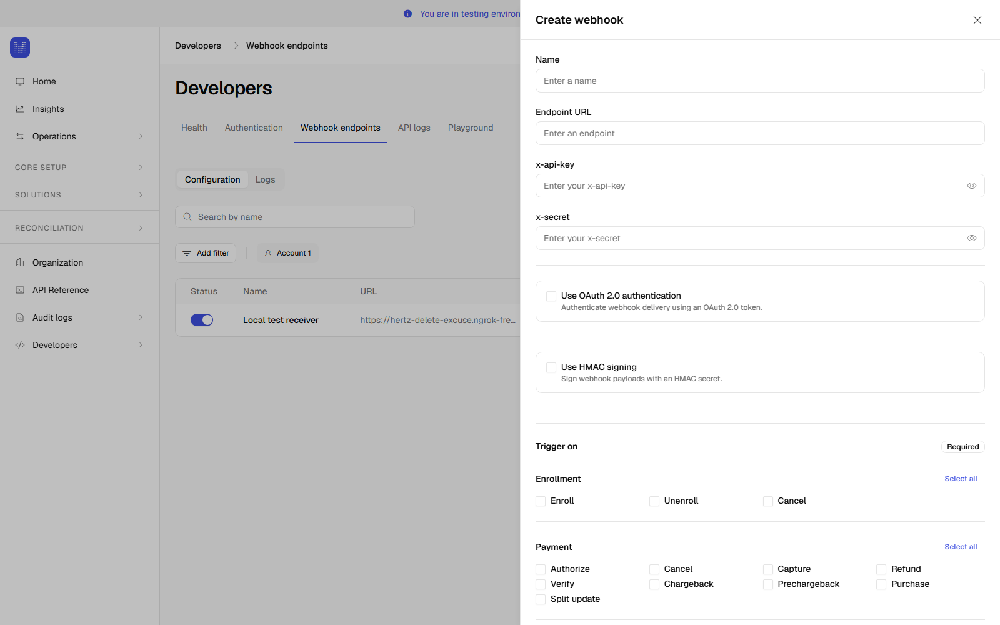
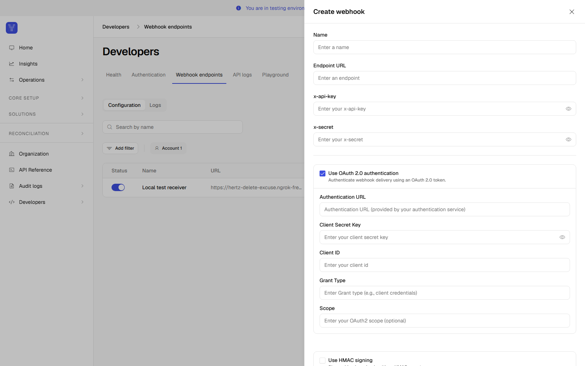

Um webhook é configurado da mesma forma, seja qual for o meio usado, com uma `url` de destino, pelo menos um gatilho e, opcionalmente, a forma como a Yuno se autentica no seu endpoint. Veja [Eventos e gatilhos](/pt-br/docs/webhooks/events) para o catálogo completo de eventos que você pode selecionar.

A `url` do webhook e, se você usar OAuth2, a URL de autenticação devem ser endpoints acessíveis publicamente (a URL de autenticação OAuth2 deve usar HTTPS). A Yuno não chama URLs que resolvem para endereços de rede privados ou internos, incluindo endereços IP nessas faixas.

<Tabs>
  <Tab title="Dashboard">
    1. Acesse a aba **Developers**
    2. Clique em **Webhook endpoints**
    3. Clique em **Add webhook**

    Será aberto um painel onde você vai configurar:

    * **Name**: identifica o seu webhook
    * **Endpoint URL**: a URL do seu servidor que vai receber as notificações
    * **x-api-key**: a sua chave de API, enviada nos cabeçalhos da notificação (`api_key` pela API)
    * **x-secret**: o seu secret, enviado nos cabeçalhos da notificação (`secret` pela API)
    * **Use OAuth 2.0 authentication**: caixa de seleção opcional para OAuth2
    * **Use HMAC signing**: caixa de seleção opcional para verificação de assinatura HMAC
    * **Trigger on**: selecione quais eventos vão disparar este webhook, agrupados por categoria (cadastro, pagamento, relatório, assinatura, onboarding), cada uma com seu próprio link **Select all**
    * **Apply to accounts**: para organizações com mais de uma conta, escolha a quais contas este webhook se aplica. O padrão é a conta atual.

    Depois de configurado, o webhook vai enviar notificações sempre que os eventos selecionados ocorrerem. A imagem abaixo mostra o painel para adicionar um webhook.

    <Frame></Frame>

    Na aba Developers do [Dashboard da Yuno](https://dashboard.y.uno/), você pode ativar e desativar webhooks usando o botão de alternância **Status**.
  </Tab>
  <Tab title="API">
    Envie a `url` de destino, um `name` único e pelo menos um gatilho para [Criar um webhook](/pt-br/reference/webhooks/create-webhook):

    ```bash cURL
    curl -X POST 'https://api-sandbox.y.uno/v1/webhooks' \
      -H 'public-api-key: <YOUR_PUBLIC_API_KEY>' \
      -H 'private-secret-key: <YOUR_PRIVATE_SECRET_KEY>' \
      -H 'Content-Type: application/json' \
      -d '{
        "account_id": "<ACCOUNT_ID>",
        "name": "Order updates",
        "url": "https://your-endpoint.example.com/yuno-webhooks",
        "payment_triggers": ["AUTHORIZE", "PURCHASE"]
      }'
    ```

    A resposta inclui o `id` que você usa para [consultar](/pt-br/reference/webhooks/retrieve-webhook), [atualizar](/pt-br/reference/webhooks/update-webhook) ou [excluir](/pt-br/reference/webhooks/delete-webhook) o webhook. Veja a [referência completa da API de webhooks](/pt-br/reference/webhooks) para todos os campos, incluindo a autenticação de entrega e as respostas de erro.
  </Tab>
</Tabs>

Acesse a página [Payloads e exemplos](/pt-br/docs/webhooks/object-and-examples) para ver exemplos de eventos de notificação de pagamento, cadastro e muitos outros.

### Autenticação HMAC {#hmac-authentication}

Marque **Use HMAC signing** no Dashboard e preencha o campo **Client Secret Key**, ou defina `hmac_client_secret` pela API. Em ambos os casos, a Yuno usa essa chave para gerar uma assinatura HMAC-SHA256 e a envia no cabeçalho `x-hmac-signature` em cada entrega, para que você possa verificar se um webhook realmente veio da Yuno e não foi adulterado.

Veja o guia [Verificar assinaturas de webhook (HMAC)](/pt-br/docs/webhooks/verify-webhook-signatures-hmac) para os detalhes de implementação.

### OAuth2 {#oauth2}

Marque **Use OAuth 2.0 authentication** no Dashboard, ou defina os campos correspondentes pela API, para que a Yuno possa obter o token que envia em cada entrega:

| Campo no Dashboard | Campo na API | Descrição |
| :--------------- | :-------- | :----------- |
| Authentication URL | `oauth2_authentication_url` | O seu endpoint de token, via HTTPS. |
| Client ID | `oauth2_client_id` | O identificador de cliente com o qual a Yuno se autentica. |
| Client Secret Key | `oauth2_client_secret` | O client secret com o qual a Yuno se autentica. |
| Grant Type | `oauth2_grant_type` | O grant type com o qual a Yuno solicita o token, normalmente `client_credentials`. |
| Scope (optional) | `oauth2_scope` | O scope OAuth2 a solicitar, se o seu serviço de autenticação exigir um. |

<Note>
A API também expõe `oauth2_authorization_name` (o cabeçalho em que a Yuno envia o token, com padrão `Authorization`) e `oauth2_include_client_id`. Eles ainda não têm equivalente no Dashboard. Veja [OAuth2](/pt-br/reference/webhooks#oauth2) para a referência completa dos campos.
</Note>

<Frame></Frame>
