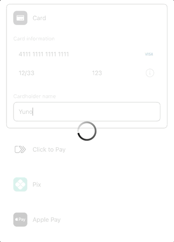

`showLoading` é invocado quando o SDK entra ou sai de um estado de carregamento. Por padrão, o SDK mostra o próprio indicador de carregamento em tela cheia; sobrescreva este controller para renderizar o seu.

## O indicador de carregamento padrão {#the-loader-you-get-by-default}

Enquanto o SDK trabalha (criação do pagamento, 3DS, carregamento dos formulários), os compradores 
veem um spinner simples:

<div className="media-showcase media-showcase-narrow">
  
  <p>O spinner padrão, exibido enquanto o SDK trabalha.</p>
</div>

## Quer usar o seu próprio indicador de carregamento? {#want-your-own-loader-instead}

Sobrescreva `showLoading` e renderize o que combinar com a sua marca.

Se você não sobrescrever este controller, o SDK mostra um indicador de carregamento em tela cheia durante a tokenização, a criação do pagamento, o 3DS e a consulta de status. Isso também vale quando você sobrescreve `showView` e incorpora o formulário do SDK na sua própria tela: no Android, o indicador cobre a Activity que você passa para `Transaction.start`, então nada é renderizado dentro do seu layout e o botão voltar é ignorado enquanto ele está na tela. Uma exceção no iOS: enquanto a lista de `getPaymentMethodsViews` está na tela e o SDK não tem nenhuma view própria apresentada, o indicador de carregamento é a própria lista, esmaecida e com um spinner, para que o comprador continue vendo-a. Assim que uma view do SDK aparece, o indicador passa para ela.

Quando você o sobrescreve, o SDK não mostra nenhum indicador de carregamento próprio. Em vez disso, ele emite `isLoading: true` ao entrar em um estado de carregamento e `isLoading: false` ao sair dele. Você renderiza o seu indicador com base nesses valores. Na Web, trate cada chamada como o estado atual (mostrar ou ocultar), em vez de contar as chamadas. Um `start()` headless ou de secure fields pode informar `true` mais de uma vez antes do `false` correspondente.

O controller pode ser invocado várias vezes durante uma única transação, conforme o SDK entra e sai de estados de carregamento.

No iOS, você pode manter o indicador do SDK em alguns fluxos e mostrar o seu em outros. Chame `SdkPayments.defaultShowLoading(isLoading:)` a partir da sua sobrescrita para executar o comportamento padrão:

```swift
func showLoading(isLoading: Bool) {
    guard usesOwnLoader else {
        SdkPayments.defaultShowLoading(isLoading: isLoading)
        return
    }
    spinner.isHidden = !isLoading
}
```

No React Native, chame `SdkPayments.defaultShowLoading(isLoading)` a partir da sua sobrescrita:

```tsx
showLoading: (isLoading) => {
  if (!usesOwnLoader) {
    SdkPayments.defaultShowLoading(isLoading);
    return;
  }
  setLoading(isLoading);
},
```

## Assinatura {#signature}

<Tabs>
  <Tab title="Web">

```typescript
sdkPayments.transaction({
  ...,
  showLoading: (isLoading) => mySpinner.toggle(isLoading),
})
```

  </Tab>

  <Tab title="iOS">

```swift
func showLoading(isLoading: Bool)
```

  </Tab>

  <Tab title="Android">

```kotlin
fun showLoading(isLoading: Boolean)
```

  </Tab>

  <Tab title="React Native">

```typescript
showLoading?(isLoading: boolean): void
```

  </Tab>
</Tabs>

## Threads {#threading}

No iOS e no Android, `showLoading` é invocado na thread principal. Você pode atualizar a UI diretamente dentro desse handler. No React Native, ele é executado na thread do JavaScript: atualize o estado do seu componente a partir dele.

## Relacionados {#related}

- [`showView`](/pt-br/docs/yuno-sdk/controllers/show-view) (iOS, Android, React Native). Controla a renderização do formulário.
