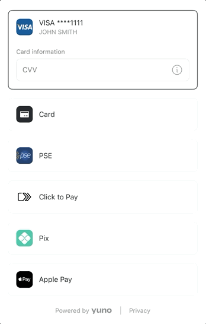
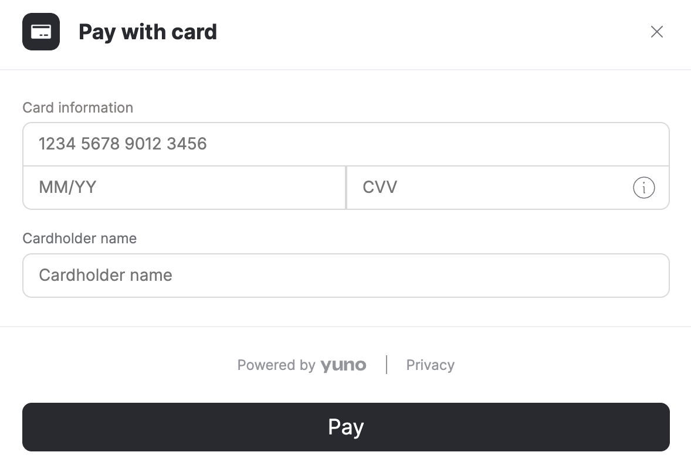
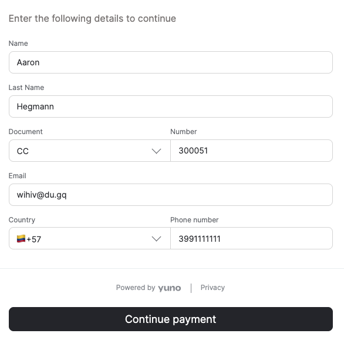
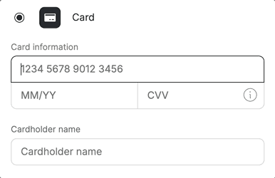
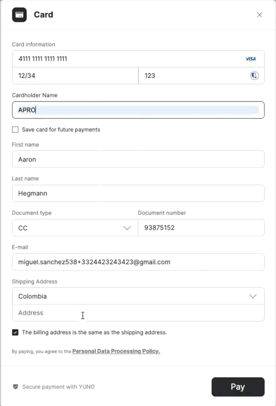

O SDK renderiza um formulário integrado: número do cartão, data de validade, código de segurança e nome do titular do cartão, além de campos de cliente e de endereço quando o meio de pagamento precisa deles. Tudo nesta página já vem pronto: sem configuração, sem código extra.

## Mostre os formulários abertos {#unfold-the-forms}

Configure os nossos formulários abertos e o formulário de cada meio já aparece 
aberto dentro da lista de meios de pagamento, para que os compradores informem os seus dados 
sem um toque extra. Você ativa isso no **Checkout Builder** do 
seu [Dashboard da Yuno](https://dashboard.y.uno/), sem precisar de código.

  
  
Aberto: o formulário já está aberto, os compradores só precisam digitar.

## Este é o nosso formulário {#this-is-what-our-form-looks-like}

Um único design, renderizado de forma nativa em todas as plataformas.

<Tabs>
  <Tab title="Cartão">
    

      
    

  </Tab>
  <Tab title="Meios de pagamento alternativos">
    

      
      
O formulário de APM: os dados do cliente que o meio exige, nada mais.

    

  </Tab>
</Tabs>

<Note>
A quantidade de campos que o formulário mostra depende do provedor do meio de pagamento 
e das informações extras que você decidir exigir. Você configura as duas coisas 
no **Checkout Builder** do seu [Dashboard da Yuno](https://dashboard.y.uno/).
</Note>

## O cursor avança por você {#the-cursor-moves-for-you}

Os compradores só digitam. À medida que cada campo é concluído, o foco pula para o próximo, sem toques entre os campos. O número do cartão é formatado e a bandeira é detectada enquanto eles digitam.

  
  
O foco avança sozinho: número → validade → CVV → nome.

## Endereços preenchidos automaticamente {#addresses-fill-themselves}

Cartões salvos no dispositivo são preenchidos com um toque. No iOS e no Android, quando o comprador digita o CEP, o SDK completa a rua, a cidade e o estado para ele. Na Web, o preenchimento automático de endereço depende da configuração de preenchimento automático de endereço da sua conta. Com ela ativada, o formulário de endereço oferece busca de endereço e, para o Brasil, completa o endereço a partir do CEP. Com ela desativada, o comprador digita os campos de endereço.

  
  
Digite um CEP e o SDK preenche o resto.

## Relacionados {#related}

- [Mostrar uma lista de meios](/pt-br/docs/yuno-sdk/features/payment-methods-list). A lista de meios de pagamento pronta, com os botões express incluídos.
- [Estilizar o checkout](/pt-br/docs/yuno-sdk/features/styling). Personalize a aparência visual do formulário.
- [TransactionConfig](/pt-br/docs/yuno-sdk/reference/objects-you-pass#transaction-config). Referência completa de configuração.
