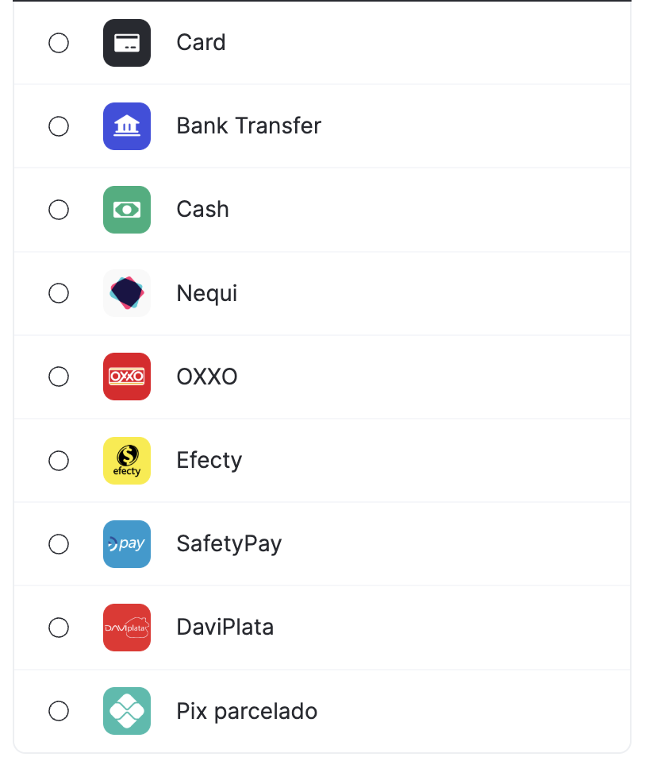
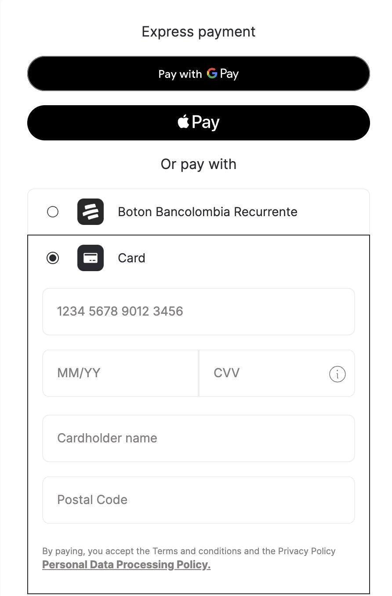
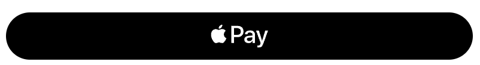

`getPaymentMethodsViews` retorna views prontas para os meios de pagamento que você quer mostrar. Use-o para exibir a lista completa de meios de pagamento do SDK, um botão de carteira (Apple Pay ou Google Pay) ou qualquer combinação disponível na sua plataforma.

Este recurso se aplica apenas a fluxos de pagamento. Ele não está disponível para cadastro.

<Note>
**A lista serve apenas para seleção.** Ela renderiza os meios de pagamento para o comprador escolher, mas não processa pagamentos sozinha. Depois que o comprador escolhe um meio, você inicia a transação para processar o pagamento. Isso torna a lista combinável com qualquer fluxo de pagamento, incluindo integrações headless em que você mesmo coleta os dados de pagamento na sua própria UI. Monte a lista para a seleção do meio, receba a seleção pelo callback de seleção ou pelo controller e inicie a transação com os seus próprios dados de pagamento já coletados. Consulte os guias de migração headless ([Web](/pt-br/docs/yuno-sdk/migration/web/headless), [iOS](/pt-br/docs/yuno-sdk/migration/ios/payment/headless), [Android](/pt-br/docs/yuno-sdk/migration/android/payment/headless), [React Native](/pt-br/docs/yuno-sdk/migration/react-native/payment/headless)) para mais detalhes.
</Note>

## Compacto ou expandido: escolha o layout {#compact-or-unfolded-choose-the-layout}

O SDK renderiza a lista completa de meios de pagamento habilitados no seu dashboard, incluindo logos, nomes e os meios salvos do comprador. E, se você preferir menos toques, pode mostrar o formulário de cada meio expandido dentro da própria lista, para que os compradores informem os dados sem sair dela, em um checkout mais rápido. Você habilita o layout expandido no **Checkout Builder** do seu [Yuno Dashboard](https://dashboard.y.uno/), sem precisar de código.

<Columns cols={2}>
  <div className="media-showcase">
    
    <p>Lista compacta: os compradores selecionam um meio para abrir o formulário dele separadamente.</p>
  </div>
  <div className="media-showcase">
    
    <p>Exibição expandida: os formulários se expandem diretamente na lista para um checkout mais rápido.</p>
  </div>
</Columns>

### Layout compacto (padrão) {#compact-layout-default}

O layout compacto é o comportamento padrão, pronto para uso. Ele não exige nenhuma configuração no dashboard:

- A lista exibe os logos e nomes dos meios de pagamento e os meios salvos.
- O comprador toca em um meio para selecioná-lo.
- Iniciar a transação abre ou monta o formulário de pagamento desse meio separadamente para coletar os dados, ou você dispara o envio a partir do seu próprio botão de pagar personalizado.

<Tip>
**Combine a seleção compacta com o modo headless.** Como o modo compacto funciona apenas como um menu de seleção, você pode usá-lo junto com uma integração headless. Monte a lista para a seleção do meio, receba a escolha do comprador pelo callback ou controller da sua plataforma e inicie a transação passando os seus próprios dados de pagamento coletados. Consulte os guias de migração headless ([Web](/pt-br/docs/yuno-sdk/migration/web/headless), [iOS](/pt-br/docs/yuno-sdk/migration/ios/payment/headless), [Android](/pt-br/docs/yuno-sdk/migration/android/payment/headless), [React Native](/pt-br/docs/yuno-sdk/migration/react-native/payment/headless)) para ver exemplos de código.
</Tip>

### Layout expandido {#unfolded-layout}

O layout expandido abre o formulário de cada meio de pagamento diretamente dentro da linha da lista, permitindo que os compradores informem os dados do cartão ou de pagamento na hora, sem telas separadas nem toques extras.

Para habilitá-lo, ative **Checkout Builder → Styling → Unfolded display** no seu [Yuno Dashboard](https://dashboard.y.uno/).

Quando o layout expandido está ativo:
- Selecionar um meio expande o formulário de pagamento dele diretamente no item da lista.
- Iniciar a transação envia o formulário já preenchido na lista.
- As carteiras express (Apple Pay, Google Pay, PayPal) renderizam os botões nativos diretamente na linha.

## Antes de começar {#before-you-start}

O seu backend precisa ter criado uma `checkoutSession`, e a `Transaction` precisa ser construída com essa sessão. Consulte [Primeiros passos](/pt-br/docs/yuno-sdk/get-started).

## Implementação {#implementation}

Chame `getPaymentMethodsViews` com os tipos que você quer e um controller. O SDK retorna um mapa de `PaymentMethodType` para view. Incorpore cada view no seu layout. Quando o usuário escolhe um meio, o seu controller recebe um `PaymentMethodSelected`, que você passa para `Transaction.start()`.

<Tabs>
  <Tab title="Web">

```typescript
let selectedPaymentMethod: PaymentMethodSelected | null = null

const views = transaction.getPaymentMethodsViews({
    types: ['applePay', 'googlePay', 'paymentMethodList'],
    onPaymentSelected: (paymentMethod) => {
        selectedPaymentMethod = paymentMethod
    },
})

views.applePay?.mount({ elementSelector: '#apple-pay', buttonType: 'buy', buttonStyle: 'black' })
views.googlePay?.mount({ elementSelector: '#google-pay', buttonColor: 'black' })
views.paymentMethodList?.mount({ elementSelector: '#payment-list' })

// Later, when the user confirms (e.g. your Pay button):
if (selectedPaymentMethod) {
    transaction.start({ paymentMethod: selectedPaymentMethod })
}
```

Cada view no objeto retornado expõe um método `.mount({ elementSelector, ...config })`. A estilização de cada view (tipo de botão do Apple Pay, cor do Google Pay etc.) fica em `.mount()`. As opções que você passa para o `mount()` de uma carteira sobrescrevem as mesmas chaves em `externalButtons` da configuração da transação. `paymentMethodList.mount()` também aceita `scrollContainerSelector`, `visibleTriggerOffsetPx` e `bottomOffsetPx` para uma lista dentro de um contêiner com rolagem. Eles sobrescrevem as mesmas chaves em `paymentListConfig` da configuração da transação.

O que `start()` faz depois de uma seleção depende do Checkout Builder. Com os formulários expandidos dentro da lista, `start({ paymentMethod })` envia o formulário que o comprador já preencheu, então ele é a sua ação de pagar. Com os formulários recolhidos, `start()` monta o formulário do meio selecionado no `elementSelector` da configuração da sua transação e é resolvido. O comprador então paga pelo botão desse formulário. Se você definir `showPayButton: false`, chame `transaction.submit()` a partir do seu próprio botão. Passe `elementSelector` na configuração da transação para que o formulário recolhido tenha onde ser renderizado.

  </Tab>

  <Tab title="iOS">

```swift
var selectedPayment: SdkPayments.PaymentMethodSelected?

let views = transaction.getPaymentMethodsViews(
    types: [.APPLE_PAY(), .PAYMENT_METHOD_LIST],
    controller: self
)

// In your SdkPayments.PaymentListController:
func onPaymentSelected(paymentSelected: SdkPayments.PaymentMethodSelected) {
    selectedPayment = paymentSelected
}

// Later, when the user confirms (e.g. your Pay button):
if let selectedPayment {
    transaction.start(paymentSelected: selectedPayment)
}
```

As views são `AnyView`s do SwiftUI. Para um layout em UIKit, chame `getPaymentMethodsViewsUIKit(types:controller:)`: os argumentos são os mesmos, e ele retorna `[PaymentMethodType: UIView]`, pronto para adicionar como subviews.

  </Tab>

  <Tab title="Android">

```kotlin
var selectedPayment: PaymentMethodSelected? = null

val views = transaction.getPaymentMethodsViews(
    host = this,
    types = listOf(PaymentMethodType.GooglePay(), PaymentMethodType.PaymentMethodList),
    controller = this
)

// In your PaymentListController:
override fun onPaymentSelected(paymentSelected: PaymentMethodSelected) {
    selectedPayment = paymentSelected
}

// Later, when the user confirms (e.g. your Pay button):
selectedPayment?.let { transaction.start(activity = this, paymentSelected = it) }
```

  </Tab>

  <Tab title="React Native">

```tsx
import { YunoView, type PaymentMethodSelected, type YunoViewHandle } from '@yuno-payments/yuno-sdk-react-native';

const [listView, setListView] = useState<YunoViewHandle | null>(null);
const [selected, setSelected] = useState<PaymentMethodSelected | null>(null);

useEffect(() => {
  transaction
    .getPaymentMethodsViews([{ kind: 'PAYMENT_METHOD_LIST' }], {
      onPaymentSelected: setSelected,
    })
    .then((views) => setListView(views[0]?.view ?? null));
}, [transaction]);

// Later, when the user confirms (e.g. your Pay button):
// if (selected) transaction.start(selected);

return listView ? <YunoView view={listView} /> : null;
```

No React Native, `getPaymentMethodsViews` retorna uma Promise de entradas `{ type, view }` na ordem em que você as solicitou. Renderize cada `view` com `<YunoView>`; um tipo que a plataforma não suporta volta com `view: null`.

  </Tab>
</Tabs>

## PaymentMethodType {#paymentmethodtype}

| Valor | Disponível em | O que você recebe |
|---|---|---|
| `APPLE_PAY` | iOS, Web, React Native (iOS) | O botão nativo do Apple Pay, conectado para iniciar o fluxo de pagamento. No iOS, é um case de enum com valores associados: escreva-o como `.APPLE_PAY()` ou passe `type:` / `style:` para personalizar o botão. |
| `GOOGLE_PAY` | Android, Web, React Native (Android) | O botão nativo do Google Pay, conectado para iniciar o fluxo de pagamento. |
| `PAYPAL` | Web | O botão nativo do PayPal, conectado para iniciar o fluxo de pagamento. |
| `PAYPAL_BRAINTREE` | Web | O botão do PayPal para contas que processam PayPal pela Braintree. |
| `SAMSUNG_PAY` | Web | O botão do Samsung Pay, conectado para iniciar o fluxo de pagamento. |
| `REVOLUT_PAY` | Web | O botão do Revolut Pay, conectado para iniciar o fluxo de pagamento. |
| `PAYMENT_METHOD_LIST` | iOS, Android, Web, React Native | Lista completa de meios de pagamento habilitados no seu dashboard da Yuno. |

No React Native, passe objetos: `{ kind: 'PAYMENT_METHOD_LIST' }`, `{ kind: 'GOOGLE_PAY', cta, theme, cornerRadius }` e `{ kind: 'APPLE_PAY', buttonType, buttonStyle }`, com as mesmas opções de botão do SDK nativo de cada plataforma.

Na Web, passe os valores como strings em camelCase em `types`: `'applePay'`, `'googlePay'`, `'paypal'`, `'paypalBraintree'`, `'samsungPay'`, `'revolutPay'` e `'paymentMethodList'`.

No Android, um tipo que não se aplica à plataforma ou à configuração volta como `null`. No iOS, todo tipo solicitado volta com uma view. Na Web, todo tipo solicitado é retornado e a verificação acontece em `mount()`. Quando a carteira não está habilitada para a sessão de checkout, o SDK registra `There are not valid payment methods` no log, informa a falha por `onStatus`, e a promise que `mount()` retorna é rejeitada. `mount()` é tipado como `void`, então use `await` nele para capturar essa rejeição e monte apenas as carteiras habilitadas para a sessão.

<Note>
No Android, `PaymentMethodType` é uma sealed interface, e não um conjunto de constantes de string: `GOOGLE_PAY` corresponde a `PaymentMethodType.GooglePay(...)`, que também carrega a personalização do botão (`cta`, `theme`, `cornerRadius`), e `PAYMENT_METHOD_LIST` corresponde a `PaymentMethodType.PaymentMethodList`. `APPLE_PAY` não existe no Android.

No iOS, `APPLE_PAY` é um case de enum com valores associados, ambos opcionais: `.APPLE_PAY(type: .buy, style: .black)` recebe um `PKPaymentButtonType` e um `PKPaymentButtonStyle` (padrões `.plain` e `.automatic`), que carregam a personalização do botão do Apple Pay. A forma simples `.APPLE_PAY` não compila: sempre escreva `.APPLE_PAY()`.
</Note>

### Botões express {#express-buttons}

`APPLE_PAY`, `GOOGLE_PAY` e `PAYPAL` retornam os botões express nativos, prontos para uso. Você os estiliza pelos modificadores de view padrão de cada plataforma (tamanho, padding, raio dos cantos etc.). O SDK apenas adiciona um indicador de carregamento por cima enquanto o fluxo de pagamento é inicializado. Na Web, `PAYPAL_BRAINTREE`, `SAMSUNG_PAY` e `REVOLUT_PAY` também são botões express, e você estiliza todos eles pelas opções de `mount()`.

<div className="media-showcase-light">
  
  
  
</div>

<Note>
Você não precisa chamar `Transaction.start()` para botões express. Tocar no botão é a confirmação do usuário, então o SDK inicia a transação internamente e informa o resultado por `onStatus`.

Isso também vale dentro da lista na Web. Quando o comprador seleciona a linha de uma carteira express, o botão dela é renderizado dentro da linha e é o controle de pagamento. `start()` para essa seleção retorna sem fazer nada, então oculte o seu próprio botão de pagar enquanto `onPaymentSelected` informar um tipo express (`APPLE_PAY`, `GOOGLE_PAY`, `PAYPAL`, `PAYPAL_BRAINTREE`, `SAMSUNG_PAY` ou `REVOLUT_PAY`).
</Note>

## PaymentListController {#paymentlistcontroller}

O controller que você passa para `getPaymentMethodsViews`. No iOS, no Android e no React Native, apenas `onPaymentSelected` é obrigatório. Na Web, `onPaymentSelected` é opcional, mas sem ele a lista não consegue informar o que o comprador escolheu, então passe-o sempre que solicitar `'paymentMethodList'`.

| Método | Obrigatório | Plataformas | Comportamento |
|---|---|---|---|
| `onPaymentSelected(paymentSelected)` | Sim (Web: opcional) | iOS, Android, Web, React Native | Invocado quando o usuário escolhe um meio de pagamento. Passe o `PaymentMethodSelected` para `Transaction.start()`. |
| `onHeightChange(newHeight)` | Não\* | iOS, Android, React Native | Invocado quando a altura da view renderizada muda, para que você possa aplicá-la ao seu layout. |
| `onUnenroll(success)` | Não | iOS, Android, React Native | Invocado depois que o SDK tenta remover um meio de pagamento salvo a partir da lista. Recebe um booleano que indica se a remoção do cadastro foi bem-sucedida. |

<Note>
**\* `onHeightChange` é opcional de _implementar_, mas você precisa aplicar a altura informada quando o seu layout restringe a lista.**
</Note>

Na Web e no iOS, `onPaymentSelected` pode ser disparado antes de qualquer toque. Quando a lista pré-seleciona o meio preferido do comprador ao ser montada, o callback é executado com `selectionSource: 'auto'` (`.auto` no iOS). Um toque o executa com `selectionSource: 'user'` (`.user` no iOS). Na Web, ele também é disparado quando o comprador toca em um botão express que você montou. O `PaymentMethodSelected` da Web é `{ type, name?, vaultedToken?, selectionSource? }`. Guarde o valor mais recente e passe-o para `start()` apenas a partir do seu próprio controle de pagamento. No React Native, `selectionSource` é `'AUTO'` ou `'USER'`.

<Note>
Se a lista não puder ser carregada porque o serviço de meios de pagamento falhou, o SDK informa isso pelo `TransactionController.onStatus` com o status `INTERNAL_ERROR` e uma `message`: `source` `backend` com o código de erro do backend em `code` (o status HTTP quando o corpo não tem um) e o corpo do erro em `raw`, ou `source` `sdk` para falhas de rede, com `context` `MethodsViewImplementation.getPaymentMethods` no iOS e `paymentMethodList.getPaymentMethods` na Web. A lista fica vazia: mostre o seu próprio estado de erro ou solicite as views novamente para tentar de novo.
</Note>

<Note>
O controle **Edit / remove**, que permite ao comprador excluir um meio salvo (e é a única coisa que faz `onUnenroll` ser disparado), só é renderizado quando **`edit_payment_method_list`** está habilitado em **Checkout Builder → Styling** no seu [Yuno Dashboard](https://dashboard.y.uno/). Ele fica **desativado por padrão** no iOS e no Android, então, até você ativá-lo, os meios salvos não mostram nenhuma opção de remoção e `onUnenroll` nunca é invocado. A mesma configuração controla a opção de remoção na Web. A Web não tem o callback `onUnenroll`. Depois de uma remoção, o SDK busca novamente os meios de pagamento da sessão e a lista é renderizada de novo.
</Note>

## Observações {#notes}

- `getPaymentMethodsViews` é síncrono no iOS, no Android e na Web. No React Native, ele retorna uma Promise.
- Você pode solicitar qualquer combinação de tipos disponíveis na sua plataforma em uma única chamada.
- O `PaymentMethodSelected` entregue por `onPaymentSelected` é o que você passa para `Transaction.start()`. Consulte [Primeiros passos](/pt-br/docs/yuno-sdk/get-started).
- **Verificar a disponibilidade de meios antes de montar listas personalizadas (Web):** se você criar o seu próprio seletor de meios de pagamento em vez de usar `paymentMethodList`, use [`transaction.isPaymentMethodAvailable({ paymentMethodType })`](/pt-br/docs/yuno-sdk/reference/objects-you-receive#checking-payment-method-availability-web) para verificar se carteiras express (como `APPLE_PAY` ou `GOOGLE_PAY`) ou meios específicos podem ser renderizados no dispositivo atual e na sessão de checkout do cliente antes de exibi-los.
- Na Web, quando um pagamento da sessão chega a um status final, o SDK remove a lista e marca a sessão de checkout como finalizada. A partir daí, `start()`, `submit()` e `mount()` nessa sessão lançam erro. Para pagar de novo, crie uma nova sessão de checkout e uma nova `Transaction`, ou chame `transaction.updateCheckoutSession()` com a nova sessão, e monte a lista novamente.

## Relacionados {#related}

- [`PaymentMethodSelected`](/pt-br/docs/yuno-sdk/reference/objects-you-pass#payment-method-selected). O objeto que você recebe e passa para `start()`.
- [Primeiros passos](/pt-br/docs/yuno-sdk/get-started). Passo a passo completo da integração.
