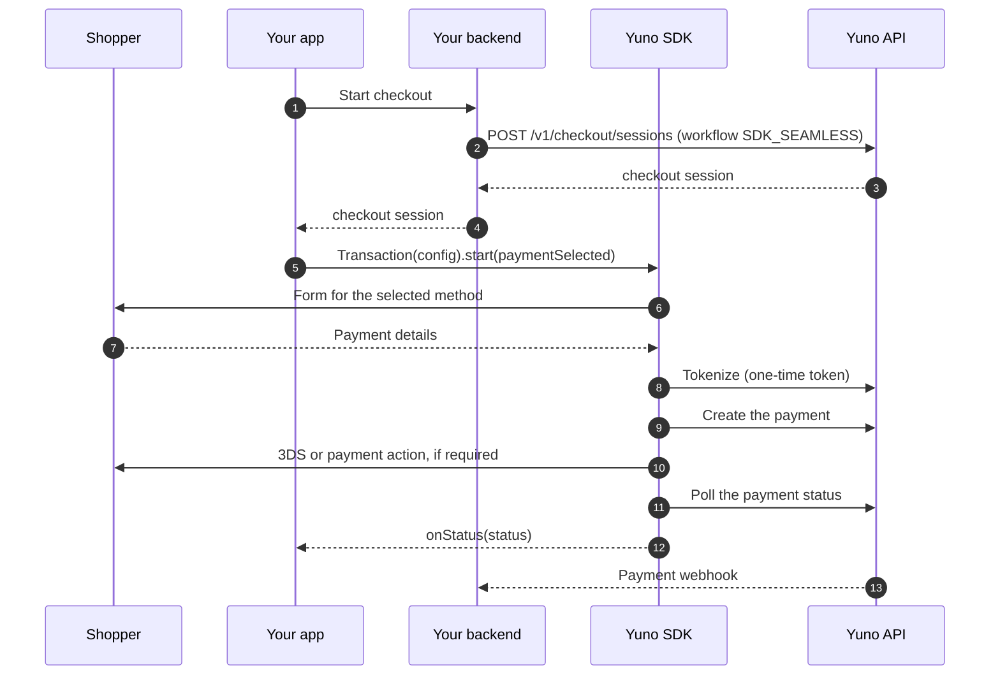
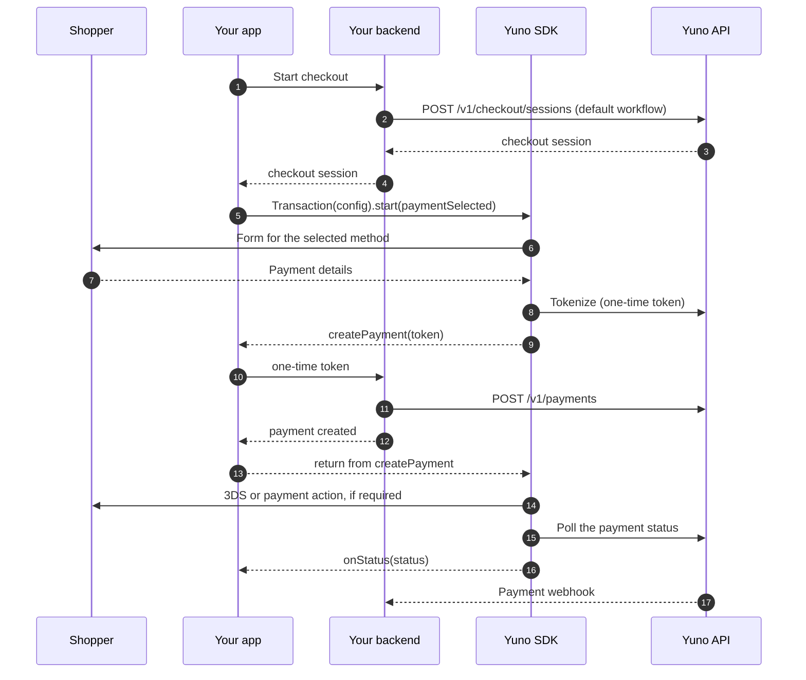
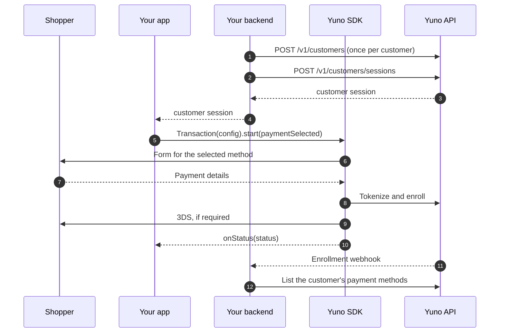

Toda integração executa a mesma sequência: o seu backend cria uma sessão, o seu app inicia uma `Transaction`, o SDK leva o comprador até um status final e o informa a `onStatus`, e a Yuno confirma o resultado ao seu backend. O que muda entre as integrações é quem cria o pagamento e qual sessão você passa. Os três fluxos abaixo cobrem todos os casos.

## O fluxo padrão: o SDK cria o pagamento {#the-default-flow-the-sdk-creates-the-payment}

Crie a sessão de checkout com `workflow: "SDK_SEAMLESS"` e não sobrescreva `createPayment`. O SDK faz tudo entre `start` e `onStatus`.

1. O seu backend cria a sessão de checkout e entrega o ID dela ao seu app.
2. O seu app inicializa o SDK uma vez, monta uma `TransactionConfig` com a sessão e o seu controller e chama `start` com o meio que o comprador escolheu.
3. O SDK renderiza o formulário do meio, ou o pula quando você passa `transactionData`, e tokeniza os dados em um token de uso único.
4. O SDK cria o pagamento com esse token, executa o 3DS ou qualquer outra ação de que o meio precise e consulta o status até que ele seja final.
5. `onStatus` recebe o status final. No iOS, os meios assíncronos informam `PENDING` primeiro; veja [`onStatus`](/pt-br/docs/yuno-sdk/controllers/on-status). Se `showStatusScreen` for `true`, o SDK também mostra a sua tela de resultado.
6. A Yuno envia o webhook de pagamento ao seu backend. Confirme o resultado lá antes de atender o pedido.

## Quando o seu backend cria o pagamento {#when-your-backend-creates-the-payment}

Sobrescreva `createPayment` e mantenha o workflow de sessão padrão (`SDK_CHECKOUT`). O SDK pausa depois da tokenização, entrega o token a você e retoma quando o seu handler retorna.

A diferença está nos passos 9 a 13: o SDK entrega o token de uso único a `createPayment`, o seu backend cria o pagamento, e é o retorno do handler que retoma o fluxo. Se o handler lançar um erro, o fluxo para e `onStatus` não é chamado. Defina `autoContinuePayment` como `false` somente se você precisar que o SDK pare logo depois que o pagamento for criado. Na Web, isso só se aplica quando você sobrescreve `createPayment`; no iOS, também se aplica à criação de pagamento feita pelo próprio SDK. Nesse caso, o SDK não executa 3DS, não consulta o status e não informa nada a `onStatus` nessa tentativa. Na Web, o PayPal ignora a flag e sempre continua. Veja [`autoContinuePayment`](/pt-br/docs/yuno-sdk/reference/objects-you-pass#autocontinuepayment).

<Warning>
O `workflow` da sessão precisa corresponder a quem cria o pagamento. Uma sessão com o workflow padrão sem sobrescrita de `createPayment` termina em `INTERNAL_ERROR`: o backend rejeita a criação do pagamento pelo SDK. Veja [`createPayment`](/pt-br/docs/yuno-sdk/controllers/create-payment).
</Warning>

## Cadastro: salvar um meio sem fazer cobrança {#enrollment-save-a-method-without-charging}

Passe uma `customerSession` em vez de uma `checkoutSession`. Não há pagamento a criar, então `createPayment` nunca é chamado.

O vaulted token nunca é entregue ao app. Depois que `onStatus` informar sucesso, o seu backend lê na Yuno o meio cadastrado e usa o vaulted token dele em pagamentos futuros.

## Onde cada passo está documentado {#where-each-step-is-documented}

| Passo | Página |
|---|---|
| Criar sessões e o primeiro pagamento | [Primeiros passos](/pt-br/docs/yuno-sdk/get-started) |
| Escolher quem cria o pagamento, coleta os dados e renderiza o formulário | [Por onde eu começo?](/pt-br/docs/yuno-sdk/where-do-i-start) |
| `createPayment` e o workflow da sessão | [`createPayment`](/pt-br/docs/yuno-sdk/controllers/create-payment) |
| O status final e a confirmação dele no seu servidor | [`onStatus`](/pt-br/docs/yuno-sdk/controllers/on-status) |
| Cadastro com uma sessão de cliente | [Cadastro](/pt-br/docs/yuno-sdk/features/enrollment) |
| Retornar de um app ou de uma página externa (iOS) | [Tratar deeplinks](/pt-br/docs/yuno-sdk/features/handle-deeplinks) |
