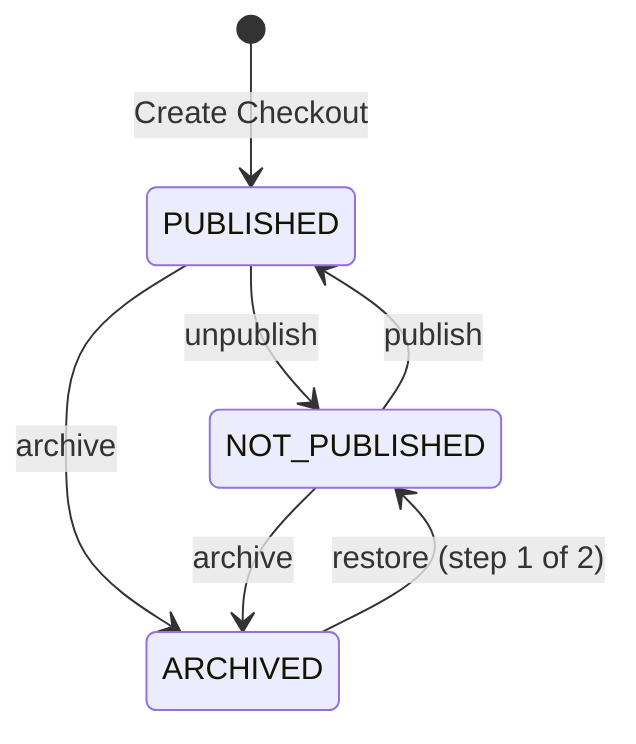

<Note>Esta API está em **Beta**. Endpoints e schemas podem mudar sem aviso prévio.</Note>

O corpo aceita qualquer combinação de `name`, `description`, `status` e `is_default`; pelo menos um campo é obrigatório. Os metadados (`name`/`description`) podem ser editados em **qualquer** status, incluindo `ARCHIVED`; a configuração e o estilo de um checkout arquivado ficam congelados (o endpoint [Publish](/pt-br/reference/checkout-builder/publish-checkout-configuration) o rejeita).

## Máquina de estados do ciclo de vida {#lifecycle-state-machine}

- **Publish** (`status: PUBLISHED`) só é válido a partir de `NOT_PUBLISHED`.
- **Restaurar é feito em duas etapas**: um checkout `ARCHIVED` volta primeiro para rascunho (`status: NOT_PUBLISHED`) e depois pode ser publicado (`status: PUBLISHED`). Um patch direto `ARCHIVED → PUBLISHED` é rejeitado com `400 INVALID_STATUS_TRANSITION`.
- Fazer patch para o status **atual** também é rejeitado com `400`.
- **Promover** (`is_default: true`) força a publicação do checkout a partir de qualquer estado (incluindo `ARCHIVED`) e rebaixa atomicamente o padrão anterior. Quando enviado junto com `status`, a promoção prevalece e `status` é ignorado. `is_default: false` é rejeitado com `400`; para rebaixar um padrão, promova outro checkout.
- O **checkout padrão é protegido**: arquivá-lo ou despublicá-lo é rejeitado com `409`, para que a loja da conta nunca fique sem um checkout ativo.
