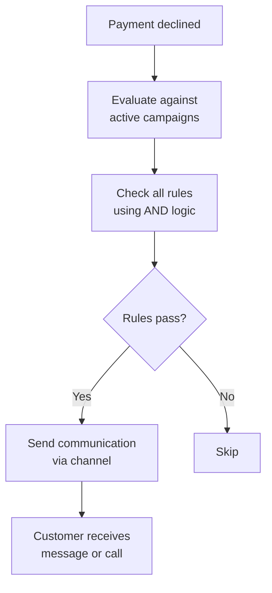

Saiba como integrar a API de Campanhas da Yuno para automatizar comunicações personalizadas de recuperação de pagamentos recusados.

## Endpoints {#endpoints}

**URL base**: `https://api-sandbox.y.uno/v1`

* [Criar campanha](/pt-br/reference/communications-campaigns/create-campaign)
* [Consultar campanha](/pt-br/reference/communications-campaigns/get-campaign)
* [Listar campanhas](/pt-br/reference/communications-campaigns/list-campaigns)
* [Atualizar status da campanha](/pt-br/reference/communications-campaigns/update-campaign-status)
* [Criar regras](/pt-br/reference/communications-campaigns/create-rules)
* [Consultar regra](/pt-br/reference/communications-campaigns/get-rule)
* [Atualizar regra](/pt-br/reference/communications-campaigns/update-rule)
* [Atualizar status da regra](/pt-br/reference/communications-campaigns/update-rule-status)

## Visão geral {#overview}

A API de Campanhas permite criar campanhas de comunicação automatizadas que são acionadas quando o pagamento de um cliente é recusado. Quando um evento de pagamento corresponde às regras de segmentação da sua campanha, a Yuno envia automaticamente uma mensagem personalizada ao cliente pelo canal configurado (WhatsApp ou ligação telefônica), ajudando a recuperar a transação que falhou.

### Conceitos principais {#key-concepts}

* **Campanha**: define quem será o público-alvo, por qual canal e quando enviar as comunicações.
* **Regras**: condições vinculadas a uma campanha que determinam quais pagamentos recusados se qualificam. Todas as regras ativas precisam ser atendidas para que um pagamento acione a campanha (lógica AND).
* **Agendamento**: controla a janela de horário diária e o fuso horário para o envio das comunicações.
* **Duração**: as datas de início e de término durante as quais a campanha fica ativa.

## Como funciona {#how-it-works}



**Exemplo**: você cria uma campanha voltada a pagamentos recusados na Colômbia com valores acima de 50,000 COP. Quando o pagamento de 80,000 COP de um cliente colombiano é recusado, a Yuno envia automaticamente uma mensagem de WhatsApp com uma sugestão de recuperação personalizada.

## Autenticação {#authentication}

Todas as requisições à API exigem os seguintes cabeçalhos:

| Cabeçalho              | Descrição                                          | Obrigatório |
| ---------------------- | -------------------------------------------------- | -------- |
| `X-Public-Api-Key`     | Sua chave de API pública de lojista                | Sim      |
| `X-Private-Secret-Key` | Sua chave secreta privada de lojista               | Sim      |
| `Content-Type`         | Deve ser `application/json` para requisições POST/PATCH | Sim      |

```bash
curl -X GET https://api-sandbox.y.uno/v1/campaigns \
  -H "X-Public-Api-Key: your-public-api-key" \
  -H "X-Private-Secret-Key: your-private-secret-key"
```

## Modelos de dados {#data-models}

### Objeto de campanha {#campaign-object}

<div className="code-nowrap-table dense-table">

| Campo               | Tipo   | Descrição                                              |
| ------------------- | ------ | ------------------------------------------------------ |
| `id`                | UUID   | Identificador único da campanha                        |
| `name`              | string | Nome da campanha                                       |
| `account_id`        | UUID   | ID da conta na Yuno                                    |
| `organization_code` | UUID   | Identificador da organização                           |
| `country`           | string | Código do país ISO 3166-1 alpha-2                      |
| `channel`           | enum   | `WHATSAPP_MESSAGE` ou `PHONE_CALL`                     |
| `focus`             | string | Descritor opcional do foco da campanha                 |
| `schedule`          | object | Configuração de agendamento                            |
| `duration`          | object | Período em que a campanha fica ativa                   |
| `status`            | string | `ACTIVE`, `PAUSED`, `COMPLETED` ou `CANCELLED`         |
| `rules`             | array  | Regras vinculadas à campanha (incluídas no GET por ID) |
| `created_at`        | string | Timestamp de criação em ISO 8601                       |
| `updated_at`        | string | Timestamp da última atualização em ISO 8601            |

</div>

### Objeto de regra {#rule-object}

<div className="code-nowrap-table dense-table">

| Campo          | Tipo   | Descrição                                       |
| -------------- | ------ | ----------------------------------------------- |
| `id`           | UUID   | Identificador único da regra                    |
| `campaign_id`  | UUID   | ID da campanha à qual esta regra pertence       |
| `rule_type`    | string | Tipo de regra (veja a referência abaixo)        |
| `values`       | array  | Array de valores string para comparação         |
| `conditional`  | string | Operador de comparação (veja a referência abaixo) |
| `metadata_key` | string | Nome do campo de metadados (apenas para regras `METADATA`) |
| `status`       | string | `ACTIVE` ou `INACTIVE`                          |
| `created_at`   | string | Timestamp de criação em ISO 8601                |
| `updated_at`   | string | Timestamp da última atualização em ISO 8601     |

</div>

### Referência de tipos de regra {#rule-types-reference}

As regras definem quais pagamentos recusados se qualificam para uma campanha. Todas as regras ativas de uma campanha precisam ser atendidas (lógica AND) para que uma comunicação seja acionada.

#### Regras de dados do pagamento {#payment-data-rules}

Estas regras avaliam dados disponíveis diretamente no evento de pagamento.

<div className="code-nowrap-table dense-table">

| Tipo de regra | Formato dos valores | Exemplo |
| --------------------- | ------------------------ | ------------------ |
| `AMOUNT`<br />Filtra pelo valor do pagamento | `["number"]` | `["50000"]` |
| `CURRENCY`<br />Filtra pelo código da moeda | `["code"]` | `["COP"]` |
| `AMOUNT_AND_CURRENCY`<br />Verificação combinada de valor + moeda | `["amount", "currency"]` | `["50000", "COP"]` |
| `PAYMENT_STATUS`<br />Filtra pelo status do pagamento | `["status"]` | `["DECLINED"]` |

</div>

#### Regras de dados enriquecidos {#enriched-data-rules}

Estas regras avaliam dados enriquecidos da transação (meio de pagamento, provedor, dados do cartão etc.).

<div className="code-nowrap-table dense-table">

| Tipo de regra | Formato dos valores | Exemplo |
| ------------------- | ----------------- | ---------------------- |
| `PAYMENT_METHOD`<br />Filtra pelo tipo de meio de pagamento | `["method"]` | `["CARD"]` |
| `PROVIDER`<br />Filtra pelo ID do provedor de pagamento | `["provider_id"]` | `["stripe"]` |
| `CARD_BIN`<br />Filtra pelo prefixo BIN/IIN do cartão | `["bin_prefix"]` | `["411111", "552345"]` |
| `RESPONSE_CODE`<br />Filtra pelo código de resposta do provedor | `["code"]` | `["05", "51"]` |
| `ISO_RESPONSE_CODE`<br />Filtra pelo código de resposta ISO 8583 | `["code"]` | `["51", "05"]` |
| `CATEGORY`<br />Filtra pela categoria da transação | `["category"]` | `["ecommerce"]` |

</div>

#### Regras de metadados {#metadata-rules}

Avaliam campos de metadados personalizados vinculados ao pagamento.

<div className="code-nowrap-table dense-table">

| Tipo de regra | Formato dos valores | Exige `metadata_key` |
| ---------- | ------------- | ----------------------- |
| `METADATA`<br />Filtra por chave-valor de metadados personalizados | `["value"]` | Sim |

</div>

**Exemplo**: segmentar pagamentos de uma vertical de negócio específica:

```json
{
  "rule_type": "METADATA",
  "metadata_key": "vertical",
  "values": ["restaurant", "grocery"],
  "conditional": "ONE_OF"
}
```

#### Regras de limite de frequência {#rate-limiting-rules}

Controlam a frequência das comunicações para evitar o envio de mensagens demais ao mesmo usuário.

<div className="code-nowrap-table dense-table">

| Tipo de regra | Formato dos valores | Exemplo |
| -------------------- | -------------- | ------- |
| `USER_COMMS_PER_DAY`<br />Máximo de comunicações por usuário por dia | `["limit"]` | `["3"]` |
| `UNIQUE_BY_USER`<br />Uma comunicação por usuário por campanha | Não se aplica | - |

</div>

**Observações importantes sobre as regras de limite de frequência**:

* Tanto `USER_COMMS_PER_DAY` quanto `UNIQUE_BY_USER` exigem que um campo `user_id` esteja presente nos metadados do pagamento.
* `USER_COMMS_PER_DAY` **não** exige um campo `conditional`. Informe apenas `values` com o limite diário.
* `UNIQUE_BY_USER` **não** exige `values` nem `conditional`. Basta incluir o `rule_type`.

### Referência de operadores condicionais {#conditional-operators-reference}

<div className="code-nowrap-table dense-table">

| Condicional | Tipos de regra aplicáveis | Quantidade de valores |
| ----------------------- | ------------------------------------------- | ---------------------------------- |
| `EQUAL`<br />Correspondência exata | Todos | 1 |
| `NOT_EQUAL`<br />Não corresponde | Todos | 1 |
| `ONE_OF`<br />Corresponde a qualquer valor da lista | Todos | 1+ |
| `NOT_ONE_OF`<br />Não corresponde a nenhum dos valores | Todos | 1+ |
| `IN`<br />Igual a `ONE_OF` | Todos | 1+ |
| `GREATER_THAN`<br />Maior que (numérico) | `AMOUNT`, `AMOUNT_AND_CURRENCY`, `METADATA` | 1 |
| `GREATER_THAN_OR_EQUAL`<br />Maior ou igual a (numérico) | `AMOUNT`, `AMOUNT_AND_CURRENCY`, `METADATA` | 1 |
| `LESS_THAN`<br />Menor que (numérico) | `AMOUNT`, `AMOUNT_AND_CURRENCY`, `METADATA` | 1 |
| `LESS_THAN_OR_EQUAL`<br />Menor ou igual a (numérico) | `AMOUNT`, `AMOUNT_AND_CURRENCY`, `METADATA` | 1 |
| `BETWEEN`<br />Entre dois valores, inclusive (numérico) | `AMOUNT`, `AMOUNT_AND_CURRENCY`, `METADATA` | 2 (ou 3 para `AMOUNT_AND_CURRENCY`) |
| `CONTAINS`<br />Contém a substring (sem diferenciar maiúsculas e minúsculas) | `METADATA` | 1+ |
| `STARTS_WITH`<br />Começa com o prefixo | `CARD_BIN`, `METADATA` | 1+ |

</div>

<Note>
Estes operadores pertencem ao motor de regras próprio das Campanhas de comunicação. Eles **não** são os operadores
de roteamento: no roteamento, `AMOUNT` com `BETWEEN` recebe **dois** valores mais um campo
`currency` separado, e rejeita um terceiro. Veja [Condições de roteamento](/reference/organizations/routing/routing-conditions).
</Note>

> **Observação sobre `BETWEEN` com `AMOUNT_AND_CURRENCY`**: ao usar `BETWEEN` com `AMOUNT_AND_CURRENCY`, informe 3 valores: `["min", "max", "currency"]`. Para os outros tipos de regra, informe 2 valores: `["min", "max"]`.

## Primeiros passos {#getting-started}

### Passo 1: Crie uma campanha {#step-1-create-a-campaign}

Defina quem será o público-alvo, qual canal usar e quando as comunicações devem ser enviadas.

```bash
curl -X POST https://api-sandbox.y.uno/v1/campaigns \
  -H "X-Public-Api-Key: your-public-api-key" \
  -H "X-Private-Secret-Key: your-private-secret-key" \
  -H "Content-Type: application/json" \
  -d '{
    "name": "Declined Payment Recovery - Colombia",
    "account_id": "YOUR_ACCOUNT_ID",
    "organization_code": "YOUR_ORGANIZATION_CODE",
    "country": "CO",
    "channel": "WHATSAPP_MESSAGE",
    "schedule": {
      "daily_start_time": "08:00",
      "daily_end_time": "21:00",
      "time_zone": "America/Bogota"
    },
    "duration": {
      "start_at": "2025-07-01T00:00:00Z",
      "end_at": "2026-07-01T00:00:00Z"
    }
  }'
```

> **Observação**: a campanha é criada com o status `ACTIVE` por padrão. Guarde o `id` retornado para o próximo passo.

### Passo 2: Adicione regras de segmentação {#step-2-add-targeting-rules}

Defina quais pagamentos recusados devem acionar esta campanha. Use o `id` da campanha do Passo 1.

```bash
curl -X POST https://api-sandbox.y.uno/v1/campaigns/{campaign_id}/rules \
  -H "X-Public-Api-Key: your-public-api-key" \
  -H "X-Private-Secret-Key: your-private-secret-key" \
  -H "Content-Type: application/json" \
  -d '[
    {
      "rule_type": "PAYMENT_STATUS",
      "values": ["DECLINED"],
      "conditional": "EQUAL"
    },
    {
      "rule_type": "CURRENCY",
      "values": ["COP"],
      "conditional": "EQUAL"
    },
    {
      "rule_type": "AMOUNT",
      "values": ["50000"],
      "conditional": "GREATER_THAN"
    },
    {
      "rule_type": "USER_COMMS_PER_DAY",
      "values": ["2"]
    }
  ]'
```

Agora esta campanha vai acionar uma mensagem de WhatsApp quando:

* O status do pagamento for `DECLINED` **E**
* A moeda for `COP` **E**
* O valor for maior que 50,000 **E**
* O usuário tiver recebido menos de 2 comunicações hoje

### Passo 3: Verifique sua campanha {#step-3-verify-your-campaign}

Confirme que a campanha está configurada corretamente com suas regras.

```bash
curl -X GET https://api-sandbox.y.uno/v1/campaigns/{campaign_id} \
  -H "X-Public-Api-Key: your-public-api-key" \
  -H "X-Private-Secret-Key: your-private-secret-key"
```

### Passo 4: Monitore e gerencie {#step-4-monitor-and-manage}

* **Pausar** uma campanha temporariamente: `PATCH` com `{"status": "PAUSED"}`
* **Retomar** uma campanha pausada: `PATCH` com `{"status": "ACTIVE"}`
* **Desativar uma regra específica** sem excluí-la: `PATCH /rules/{rule_id}/status` com `{"status": "INACTIVE"}`
* **Encerrar** uma campanha de forma definitiva: `PATCH` com `{"status": "COMPLETED"}`

## Exemplos de casos de uso {#use-case-examples}

### 1. Recuperação básica de pagamentos recusados {#1-basic-declined-payment-recovery}

Envie uma mensagem de WhatsApp para clientes no México cujos pagamentos com cartão forem recusados.

**[Campanha](/pt-br/reference/communications-campaigns/create-campaign)**:

```json
{
  "name": "Mexico Card Recovery",
  "account_id": "YOUR_ACCOUNT_ID",
  "organization_code": "YOUR_ORGANIZATION_CODE",
  "country": "MX",
  "channel": "WHATSAPP_MESSAGE",
  "focus": "payment_recovery",
  "schedule": {
    "daily_start_time": "09:00",
    "daily_end_time": "20:00",
    "time_zone": "America/Mexico_City"
  },
  "duration": {
    "start_at": "2025-08-01T00:00:00Z",
    "end_at": "2026-08-01T00:00:00Z"
  }
}
```

**[Regras](/pt-br/reference/communications-campaigns/create-rules)**:

```json
[
  {
    "rule_type": "PAYMENT_STATUS",
    "values": ["DECLINED"],
    "conditional": "EQUAL"
  },
  {
    "rule_type": "PAYMENT_METHOD",
    "values": ["CARD"],
    "conditional": "EQUAL"
  }
]
```

### 2. Recuperação de transações de alto valor por ligação telefônica {#2-high-value-transaction-recovery-via-phone-call}

Ligue para clientes cujas transações acima de 500 USD foram recusadas.

**[Campanha](/pt-br/reference/communications-campaigns/create-campaign)**:

```json
{
  "name": "High Value Recovery - Phone",
  "account_id": "YOUR_ACCOUNT_ID",
  "organization_code": "YOUR_ORGANIZATION_CODE",
  "country": "CO",
  "channel": "PHONE_CALL",
  "focus": "payment_recovery",
  "schedule": {
    "daily_start_time": "09:00",
    "daily_end_time": "18:00",
    "time_zone": "America/Bogota"
  },
  "duration": {
    "start_at": "2025-08-01T00:00:00Z",
    "end_at": "2026-08-01T00:00:00Z"
  }
}
```

**[Regras](/pt-br/reference/communications-campaigns/create-rules)**:

```json
[
  {
    "rule_type": "PAYMENT_STATUS",
    "values": ["DECLINED"],
    "conditional": "EQUAL"
  },
  {
    "rule_type": "AMOUNT_AND_CURRENCY",
    "values": ["500", "USD"],
    "conditional": "GREATER_THAN"
  },
  {
    "rule_type": "USER_COMMS_PER_DAY",
    "values": ["1"]
  }
]
```

### 3. Recuperação por provedor com faixa de valores {#3-provider-specific-recovery-with-amount-range}

Segmente pagamentos recusados de um provedor específico dentro de uma faixa de valores.

**[Regras](/pt-br/reference/communications-campaigns/create-rules)**:

```json
[
  {
    "rule_type": "PAYMENT_STATUS",
    "values": ["DECLINED"],
    "conditional": "EQUAL"
  },
  {
    "rule_type": "PROVIDER",
    "values": ["stripe", "adyen"],
    "conditional": "ONE_OF"
  },
  {
    "rule_type": "AMOUNT",
    "values": ["10000", "500000"],
    "conditional": "BETWEEN"
  },
  {
    "rule_type": "CURRENCY",
    "values": ["COP"],
    "conditional": "EQUAL"
  }
]
```

### 4. Segmentação baseada em metadados {#4-metadata-based-segmentation}

Segmente grupos específicos de clientes usando os metadados do pagamento (por exemplo, vertical de negócio ou nível do cliente).

**[Regras](/pt-br/reference/communications-campaigns/create-rules)**:

```json
[
  {
    "rule_type": "PAYMENT_STATUS",
    "values": ["DECLINED"],
    "conditional": "EQUAL"
  },
  {
    "rule_type": "METADATA",
    "metadata_key": "vertical",
    "values": ["restaurant", "grocery"],
    "conditional": "ONE_OF"
  },
  {
    "rule_type": "METADATA",
    "metadata_key": "customer_tier",
    "values": ["premium", "gold"],
    "conditional": "ONE_OF"
  },
  {
    "rule_type": "UNIQUE_BY_USER"
  }
]
```

### 5. Exclua códigos de resposta específicos {#5-exclude-specific-response-codes}

Envie mensagens de recuperação para todos os pagamentos recusados, exceto os que têm códigos de resposta específicos que indicam fraude ou problemas permanentes.

**[Regras](/pt-br/reference/communications-campaigns/create-rules)**:

```json
[
  {
    "rule_type": "PAYMENT_STATUS",
    "values": ["DECLINED"],
    "conditional": "EQUAL"
  },
  {
    "rule_type": "ISO_RESPONSE_CODE",
    "values": ["14", "43", "59"],
    "conditional": "NOT_ONE_OF"
  }
]
```

> **Observação**: os códigos ISO `14` (número de cartão inválido), `43` (cartão roubado) e `59` (suspeita de fraude) são excluídos, pois não devem receber comunicações de recuperação.

## Tratamento de erros {#error-handling}

Todas as respostas de erro seguem um formato consistente:

```json
{
  "code": 400,
  "message": "Descriptive error message",
  "details": "Additional context (optional)"
}
```

### Códigos de status HTTP {#http-status-codes}

| Código | Descrição            | Causas comuns                                                                                              |
| ----- | --------------------- | ---------------------------------------------------------------------------------------------------------- |
| `400` | Bad Request           | UUID inválido, campos obrigatórios ausentes, parâmetros de consulta inválidos                              |
| `404` | Not Found             | A campanha ou a regra não existe                                                                           |
| `422` | Unprocessable Entity  | Falha na validação (por exemplo, tipo de regra inválido, condicional inválido para o tipo de regra, `end_at` anterior a `start_at`) |
| `500` | Internal Server Error | Erro inesperado do servidor                                                                                |

### Erros de validação comuns {#common-validation-errors}

<div className="code-nowrap-table dense-table">

| Erro                      | Causa                                       | Solução                                                                                                   |
| ------------------------- | ------------------------------------------- | --------------------------------------------------------------------------------------------------------- |
| Invalid campaign\_id      | Parâmetro de caminho que não é UUID         | Use o UUID retornado na criação da campanha                                                               |
| Invalid rule\_type        | Valor de tipo de regra não reconhecido      | Veja [Referência de tipos de regra](#rule-types-reference)                                                |
| Invalid conditional       | Condicional não válido para o tipo de regra | Veja [Referência de operadores condicionais](#conditional-operators-reference)                            |
| BETWEEN requires 2 values | O array `values` tem o número errado de elementos | Informe exatamente 2 valores: `["min", "max"]` (ou 3 para `AMOUNT_AND_CURRENCY`: `["min", "max", "currency"]`) |
| metadata\_key required    | Regra `METADATA` sem `metadata_key`         | Adicione o campo `metadata_key`                                                                           |
| Invalid status transition | Tentativa de mudar a partir de um status final | `COMPLETED` e `CANCELLED` são estados finais                                                           |

</div>
