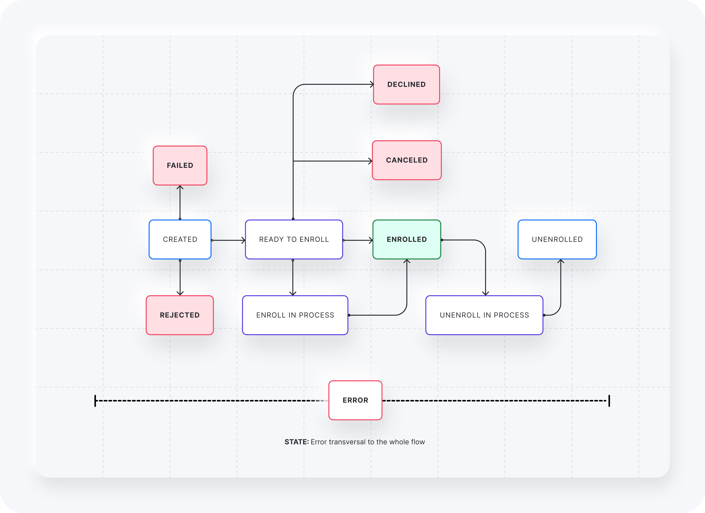

A Yuno oferece aos clientes a possibilidade de cadastrar um meio de pagamento para usá-lo em compras futuras e ter uma experiência de pagamento fluida. Esse cadastro de meio de pagamento pode ser usado tanto na implementação de pagamento [Full](/pt-br/docs/sdks/overview/understanding-flows) quanto na [Lite](/pt-br/docs/sdks/overview/quickstart) da Yuno. Ele pode ter um dos seguintes status.

## Fluxo {#workflow}

<Frame></Frame>

## Status do meio de pagamento {#payment-method-status}

| Status                | Tipo de transação | Descrição                                                   |
| :-------------------- | :--------------- | :---------------------------------------------------------- |
| `CREATED`               | Cadastro         | Estado inicial no momento da criação de um meio de pagamento. |
| `EXPIRED`               | Cadastro         | O meio de pagamento expirou.                                |
| `REJECTED`              | Cadastro         | A Yuno rejeitou o cadastro do meio de pagamento.            |
| `READY_TO_ENROLL`     | Cadastro         | O meio de pagamento está disponível para cadastro.          |
| `DECLINED`              | Cadastro         | O meio de pagamento foi recusado.                           |
| `CANCELED`              | Cadastro         | O meio de pagamento foi cancelado.                          |
| `ENROLL_IN_PROCESS`   | Cadastro         | O cadastro do meio de pagamento está sendo processado.      |
| `ENROLLED`              | Cadastro         | O cadastro do meio de pagamento foi bem-sucedido.           |
| `UNENROLL_IN_PROCESS` | Cadastro         | A remoção do cadastro do meio de pagamento está sendo processada. |
| `UNENROLLED`            | Cadastro         | O cadastro do meio de pagamento foi removido.               |
| `ERROR`                 | Cadastro         | Ocorreu um erro no cadastro do meio de pagamento.           |

