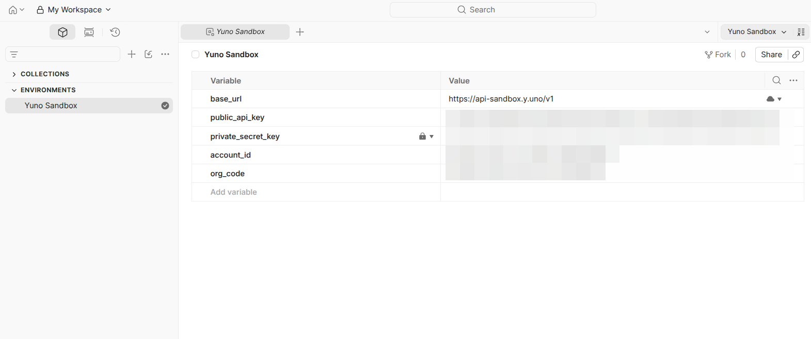
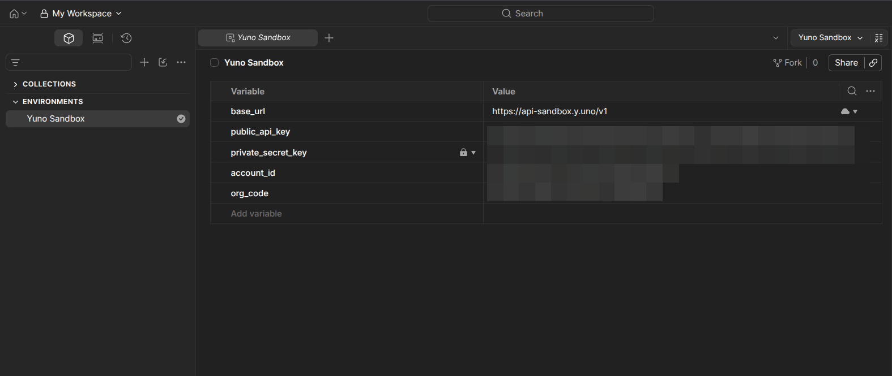
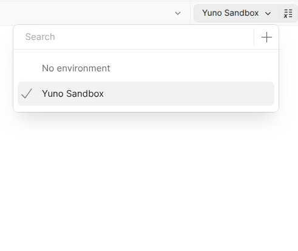
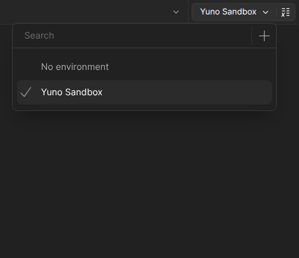

A coleção da Yuno no Postman tem todos os endpoints da [Referência da API](/pt-br/reference/getting-started/api-reference-overview), na mesma ordem da barra lateral. Importe dois arquivos, cole suas chaves de sandbox e envie seu primeiro pagamento.

<CardGroup cols={2}>
  <Card title="Coleção" icon="download" href="/files/postman/Yuno_API.postman_collection.json">
    `Yuno_API.postman_collection.json`
  </Card>
  <Card title="Ambiente sandbox" icon="download" href="/files/postman/Yuno_Sandbox.postman_environment.json">
    `Yuno_Sandbox.postman_environment.json`
  </Card>
</CardGroup>

Você precisa de:

- [Postman](https://www.postman.com/downloads/), desktop ou web
- Uma conta sandbox da Yuno
- Uma conexão de cartão com uma rota nessa conta. O [Yuno Testing Gateway](/pt-br/docs/direct-integration-use-cases/yuno-testing-gateway) não precisa de credenciais. Sem uma rota de cartão, o pagamento de teste da etapa 3 falha.

## Etapa 1: Importe a coleção e o ambiente {#step-1-import-the-collection-and-the-environment}

1. No Postman, selecione **Import**.
2. Cole esta URL ou solte o arquivo baixado:

```text
https://docs.y.uno/files/postman/Yuno_API.postman_collection.json
```

3. Importe o ambiente da mesma forma:

```text
https://docs.y.uno/files/postman/Yuno_Sandbox.postman_environment.json
```

<Note>
**A coleção e o ambiente são separados**

A coleção contém as requisições. O ambiente contém suas chaves de API e sua conta. O Postman precisa dos dois.
</Note>

## Etapa 2: Adicione suas chaves de sandbox {#step-2-add-your-sandbox-keys}

1. Abra **Environments** no painel à esquerda e selecione **Yuno Sandbox**.

<Frame>
  
  
</Frame>

2. Preencha estas três variáveis. Você as encontra no [Dashboard da Yuno](https://dashboard.y.uno/developers).

| Variável | Valor |
| --- | --- |
| `public_api_key` | Sua chave de API pública |
| `private_secret_key` | Sua chave secreta privada |
| `account_id` | A conta que executa os pagamentos |

<Note>
**As chaves de sandbox exigem o modo de teste**

No Dashboard da Yuno, defina o [chip de contexto](/pt-br/docs/using-yuno/account-context) na barra superior como **Test** antes de copiar suas chaves de API. Com o chip em **Live**, as chaves ficam restritas à produção e não autenticam no ambiente sandbox.
</Note>

3. Defina **Yuno Sandbox** como o ambiente ativo com o seletor no canto superior direito.

<Frame>
  
  
</Frame>

## Etapa 3: Envie seu primeiro pagamento {#step-3-send-your-first-payment}

Abra a pasta **Start here: your first payment** e envie as cinco requisições em ordem.

| Requisição | O que faz | O que salva |
| --- | --- | --- |
| 1. Create a customer | Cria o pagador | `customer_id` |
| 2. Create a checkout session | Abre a sessão que um SDK usaria | `checkout_session` |
| 3. Create a payment | Cobra um cartão de teste com o fluxo `DIRECT` | `payment_id`, `transaction_id` |
| 4. Retrieve the payment | Lê o pagamento e o status dele | |
| 5. Refund the payment | Reembolsa a transação | |

Cada requisição salva os IDs de que a próxima precisa, então você não copia nem cola nada. Depois da etapa 3, o pagamento tem `status: SUCCEEDED`. Depois da etapa 5, ele tem `status: REFUNDED`.

<Note>
A etapa 3 envia um número de cartão de teste sem tokenização. Isso funciona em sandbox. Em produção, isso exige certificação PCI, e as integrações via SDK enviam um token de uso único no lugar.
</Note>

## Como a coleção funciona {#how-the-collection-works}

- **Mesma estrutura da Referência da API.** Cada grupo da barra lateral é uma pasta, cada página de endpoint é uma requisição, e toda requisição tem um link de volta para a sua página.
- **A autenticação já está configurada.** Os cabeçalhos `public-api-key` e `private-secret-key` leem os valores do ambiente.
- **A idempotência é automática.** `X-Idempotency-Key` recebe um novo UUID a cada envio, salvo como `last_idempotency_key`.
- **Os IDs são reaproveitados.** Uma criação bem-sucedida salva o ID dela (`customer_id`, `payment_id`, `subscription_id` e assim por diante) como uma variável da coleção, e as requisições seguintes o usam.
- **Todo cenário documentado é um exemplo salvo.** Abra os exemplos de uma requisição, por exemplo os corpos de cartão, carteira digital e transferência bancária de **Create Payment**, para ver cada corpo e a resposta dele.
- **Os erros são explicados.** Uma chamada com falha mostra o código de erro, as mensagens e o trace ID no console do Postman. Envie o trace ID ao suporte quando precisar de ajuda.

## Repita uma requisição com segurança {#retry-a-request-safely}

Quando uma requisição excede o tempo limite, você não sabe se ela foi processada. Enviá-la de novo com uma nova chave de idempotência pode criar um segundo pagamento.

1. Abra a aba **Variables** da coleção.
2. Copie o valor de `last_idempotency_key` para `retry_idempotency_key`.
3. Envie a mesma requisição de novo. Se a primeira requisição criou um pagamento, a Yuno retorna esse pagamento em vez de criar um novo.
4. Limpe `retry_idempotency_key`, para que as próximas requisições recebam chaves novas.

Veja [Idempotência](/pt-br/reference/getting-started/authentication#idempotency) para as outras respostas que uma nova tentativa pode retornar.

## Execute pela linha de comando {#run-it-from-the-command-line}

Os mesmos arquivos rodam com o [Newman](https://github.com/postmanlabs/newman), por exemplo em CI. Use uma cópia do arquivo de ambiente com suas chaves preenchidas e mantenha essa cópia fora do controle de versão.

```sh
npx newman run Yuno_API.postman_collection.json \
  -e Yuno_Sandbox.postman_environment.json \
  --folder "Start here: your first payment"
```

## Produção {#production}

Importe [`Yuno_Production.postman_environment.json`](/files/postman/Yuno_Production.postman_environment.json) e preencha suas chaves de produção. As requisições enviadas com este ambiente movimentam dinheiro real. A coleção mostra um aviso no console a cada requisição de produção.

## Sempre sincronizada {#always-in-sync}

A coleção é gerada a partir da mesma [especificação OpenAPI](/openapi.json) que gera a Referência da API. Importe-a novamente para obter os novos endpoints.

## Recursos úteis {#useful-resources}

- [`Yuno_API.postman_collection.json`](/files/postman/Yuno_API.postman_collection.json)
- [`Yuno_Sandbox.postman_environment.json`](/files/postman/Yuno_Sandbox.postman_environment.json)
- [`Yuno_Production.postman_environment.json`](/files/postman/Yuno_Production.postman_environment.json)
- [Especificação OpenAPI](/openapi.json)
- [Autenticação](/pt-br/reference/getting-started/authentication)
