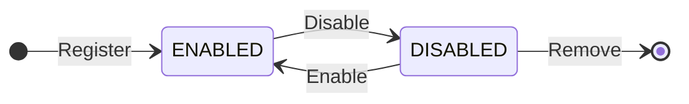

Cada host na [allowlist de destinos](/pt-br/docs/security-and-compliance/pci-proxy/allowlist) do seu PCI Proxy tem um status que controla se o [forward proxy](/pt-br/reference/pci-proxy/invoke-forward-proxy) pode enviar dados de cartão para ele. Um destino é criado no estado `ENABLED` e pode ser alternado sem perder sua configuração nem seu histórico de auditoria. Somente destinos `ENABLED` podem ser acessados. Uma requisição a um host `DISABLED` (ou removido) é rejeitada com `403 DESTINATION_NOT_ALLOWED`.

## Fluxo {#workflow}

Um destino pode ser **removido** a partir de qualquer um dos estados, habilitado ou desativado. A remoção é permanente; o registro sai da allowlist, embora a exclusão permaneça no log de auditoria append-only.

## Status do destino {#destination-status}

| Status     | Descrição                                                                                                    |
| :--------- | :----------------------------------------------------------------------------------------------------------- |
| `ENABLED`  | O destino está ativo. O forward proxy pode enviar dados de cartão para este host. Um destino começa neste estado ao ser registrado. |
| `DISABLED` | O destino está suspenso. Seu registro e seu histórico de auditoria são mantidos, mas o forward proxy não o usará até que seja reabilitado. As requisições a ele retornam `403 DESTINATION_NOT_ALLOWED`. |
| _(removido)_ | O destino foi excluído da allowlist. Ele não é mais retornado pela operação List e as requisições a ele são rejeitadas. A exclusão permanece no log de auditoria append-only. |
