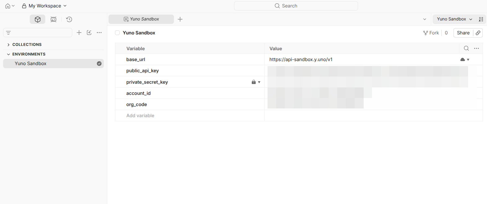
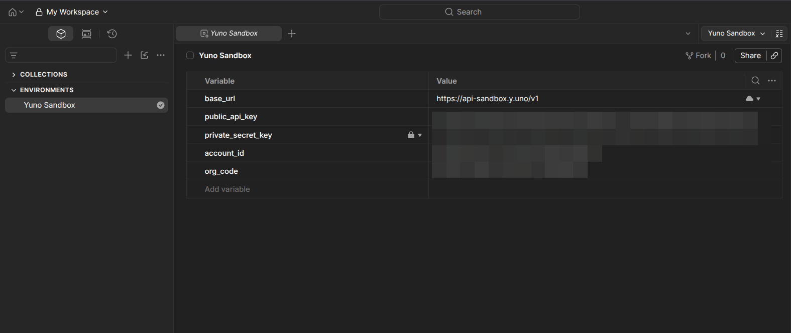
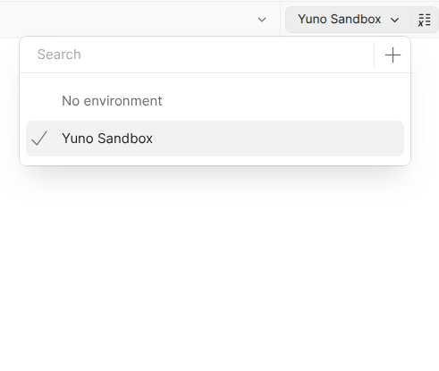
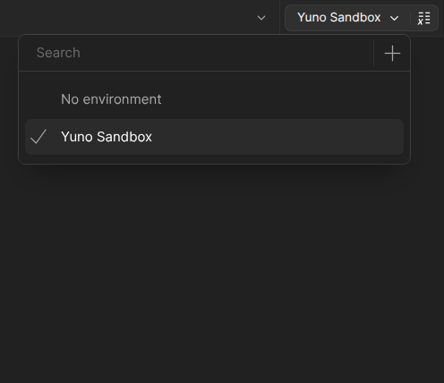

The Yuno Postman collection has every endpoint of the [API Reference](/reference/getting-started/api-reference-overview), in the same order as the sidebar. Import two files, paste your sandbox keys, and send your first payment.

<CardGroup cols={2}>
  <Card title="Collection" icon="download" href="/files/postman/Yuno_API.postman_collection.json">
    `Yuno_API.postman_collection.json`
  </Card>
  <Card title="Sandbox environment" icon="download" href="/files/postman/Yuno_Sandbox.postman_environment.json">
    `Yuno_Sandbox.postman_environment.json`
  </Card>
</CardGroup>

You need:

- [Postman](https://www.postman.com/downloads/), desktop or web
- A Yuno sandbox account
- A card connection with a route in that account. The [Yuno Testing Gateway](/docs/direct-integration-use-cases/yuno-testing-gateway) needs no credentials. Without a card route, the test payment in step 3 fails.

## Step 1: Import the collection and the environment

1. In Postman, select **Import**.
2. Paste this URL, or drop the downloaded file:

```text
https://docs.y.uno/files/postman/Yuno_API.postman_collection.json
```

3. Import the environment the same way:

```text
https://docs.y.uno/files/postman/Yuno_Sandbox.postman_environment.json
```

<Note>
**Collection and environment are separate**

The collection holds the requests. The environment holds your API keys and account. Postman needs both.
</Note>

## Step 2: Add your sandbox keys

1. Open **Environments** on the left panel and select **Yuno Sandbox**.

<Frame>
  
  
</Frame>

2. Fill in these three variables. You find them in the [Yuno Dashboard](https://dashboard.y.uno/developers).

| Variable | Value |
| --- | --- |
| `public_api_key` | Your public API key |
| `private_secret_key` | Your private secret key |
| `account_id` | The account that runs the payments |

<Note>
**Sandbox keys require test mode**

In the Yuno Dashboard, set the [context chip](/docs/using-yuno/account-context) in the top bar to **Test** before copying your API keys. With the chip on **Live**, the keys are scoped to production and won't authenticate against the sandbox environment.
</Note>

3. Set **Yuno Sandbox** as the active environment with the selector at the top right corner.

<Frame>
  
  
</Frame>

## Step 3: Send your first payment

Open the **Start here: your first payment** folder and send the five requests in order.

| Request | What it does | What it saves |
| --- | --- | --- |
| 1. Create a customer | Creates the payer | `customer_id` |
| 2. Create a checkout session | Opens the session an SDK would use | `checkout_session` |
| 3. Create a payment | Charges a test card with the `DIRECT` workflow | `payment_id`, `transaction_id` |
| 4. Retrieve the payment | Reads the payment and its status | |
| 5. Refund the payment | Refunds the transaction | |

Each request saves the IDs the next one needs, so you don't copy and paste anything. After step 3 the payment has `status: SUCCEEDED`. After step 5 it has `status: REFUNDED`.

<Note>
Step 3 sends a raw test card number. This works in sandbox. In production it requires PCI certification, and SDK integrations send a one-time token instead.
</Note>

## How the collection works

- **Same structure as the API Reference.** Each sidebar group is a folder, each endpoint page is a request, and every request links back to its page.
- **Authentication is set up.** The `public-api-key` and `private-secret-key` headers read from the environment.
- **Idempotency is automatic.** `X-Idempotency-Key` gets a new UUID on every send, saved as `last_idempotency_key`.
- **IDs carry over.** A successful create saves its ID (`customer_id`, `payment_id`, `subscription_id`, and so on) as a collection variable, and later requests use it.
- **Every documented scenario is a saved example.** Open the examples under a request, for example the card, wallet and bank transfer bodies of **Create Payment**, to see each body and its response.
- **Errors are explained.** A failed call prints the error code, the messages and the trace ID in the Postman console. Send the trace ID to support when you need help.

## Retry a request safely

When a request times out, you don't know whether it went through. Sending it again with a new idempotency key can create a second payment.

1. Open the collection **Variables** tab.
2. Copy the value of `last_idempotency_key` into `retry_idempotency_key`.
3. Send the same request again. If the first request created a payment, Yuno returns that payment instead of creating a new one.
4. Clear `retry_idempotency_key`, so the next requests get new keys.

See [Idempotency](/reference/getting-started/authentication#idempotency) for the other responses a retry can return.

## Run it from the command line

The same files run with [Newman](https://github.com/postmanlabs/newman), for example in CI. Use a copy of the environment file with your keys filled in, and keep that copy out of version control.

```sh
npx newman run Yuno_API.postman_collection.json \
  -e Yuno_Sandbox.postman_environment.json \
  --folder "Start here: your first payment"
```

## Production

Import [`Yuno_Production.postman_environment.json`](/files/postman/Yuno_Production.postman_environment.json) and fill in your live keys. Requests sent with this environment move real money. The collection prints a warning in the console on every production request.

## Always in sync

The collection is generated from the same [OpenAPI spec](/openapi.json) that builds the API Reference. Import it again to get new endpoints.

## Useful resources

- [`Yuno_API.postman_collection.json`](/files/postman/Yuno_API.postman_collection.json)
- [`Yuno_Sandbox.postman_environment.json`](/files/postman/Yuno_Sandbox.postman_environment.json)
- [`Yuno_Production.postman_environment.json`](/files/postman/Yuno_Production.postman_environment.json)
- [OpenAPI spec](/openapi.json)
- [Authentication](/reference/getting-started/authentication)
